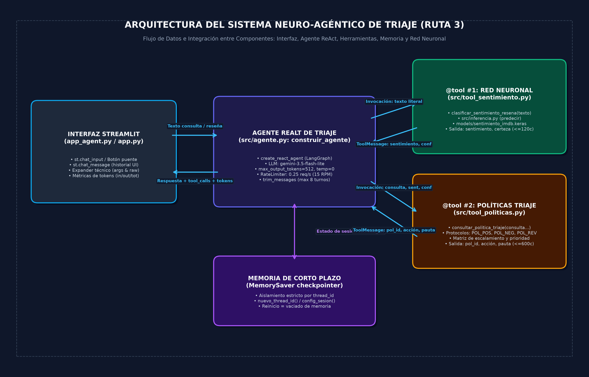
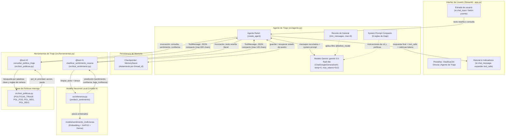
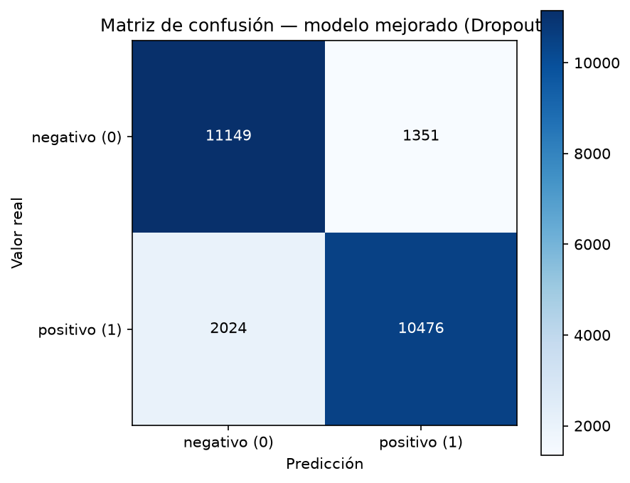
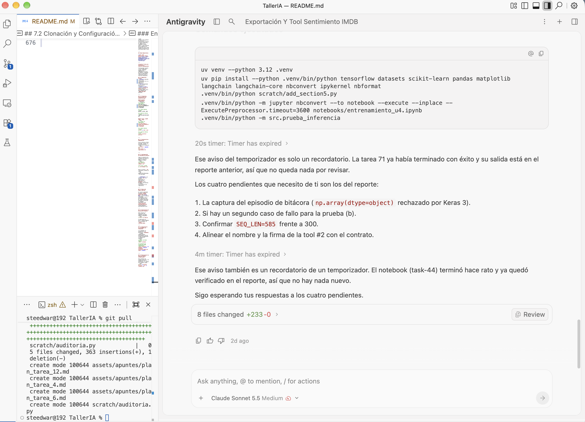
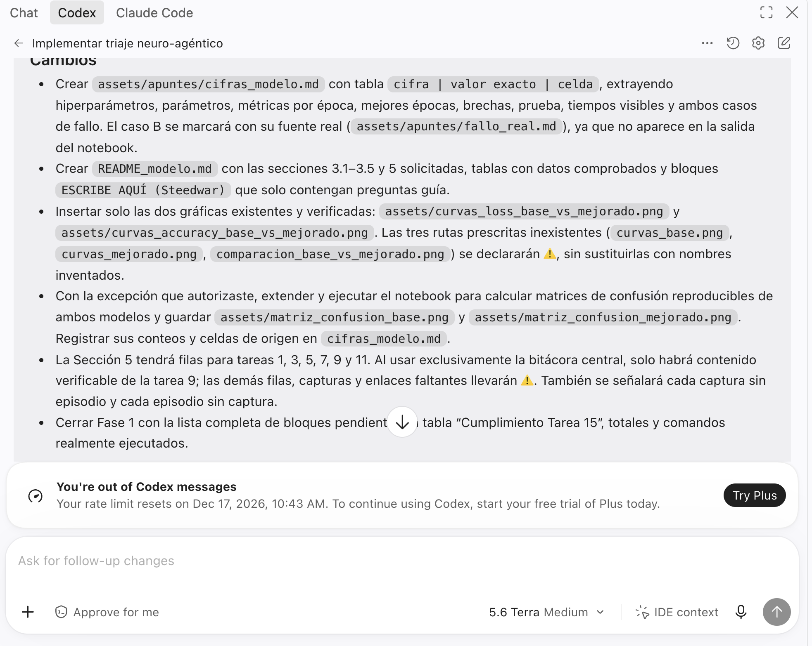
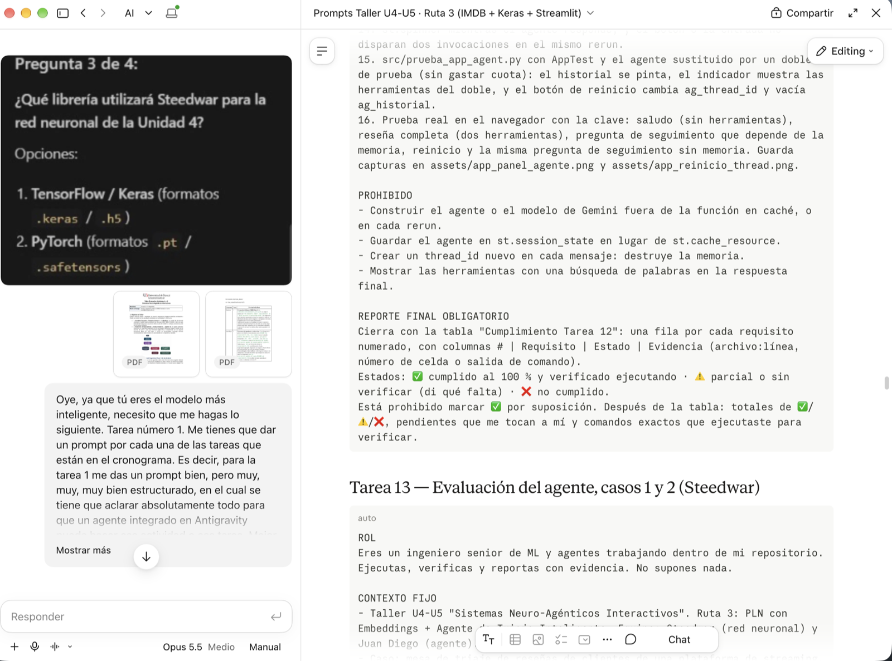
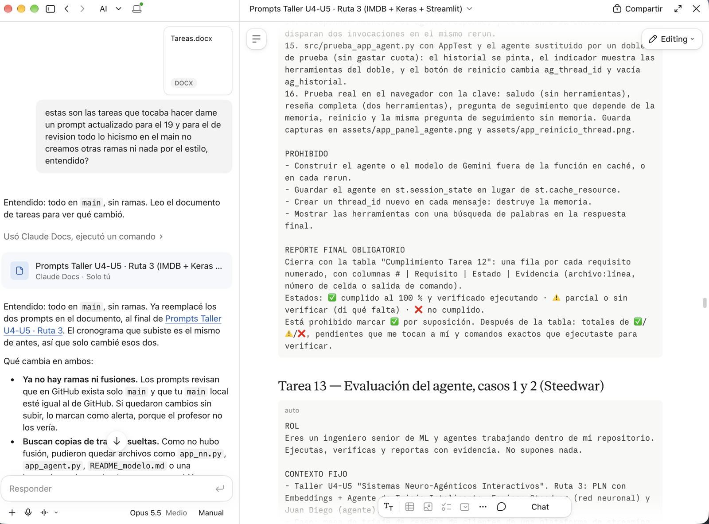
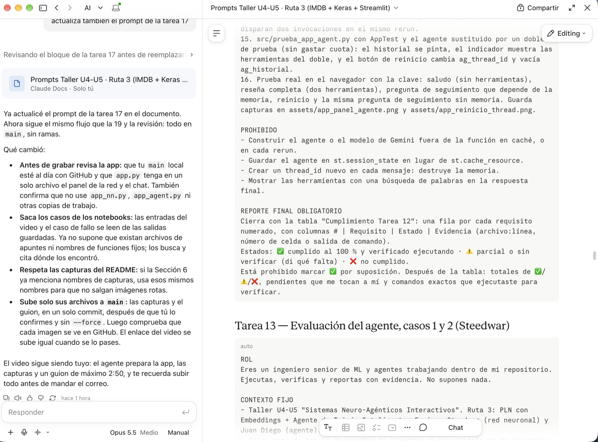
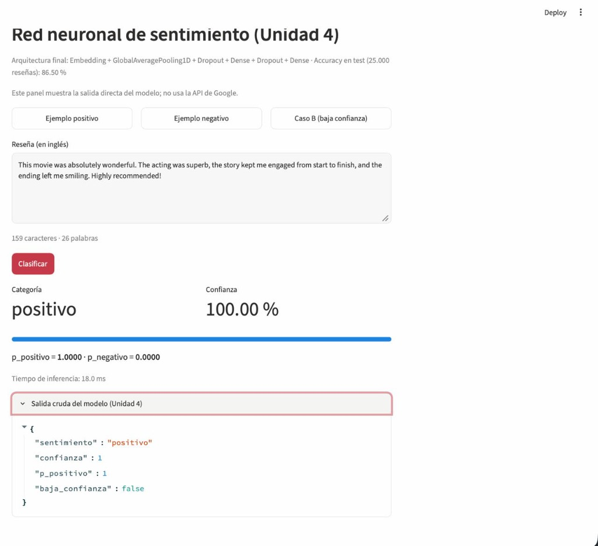
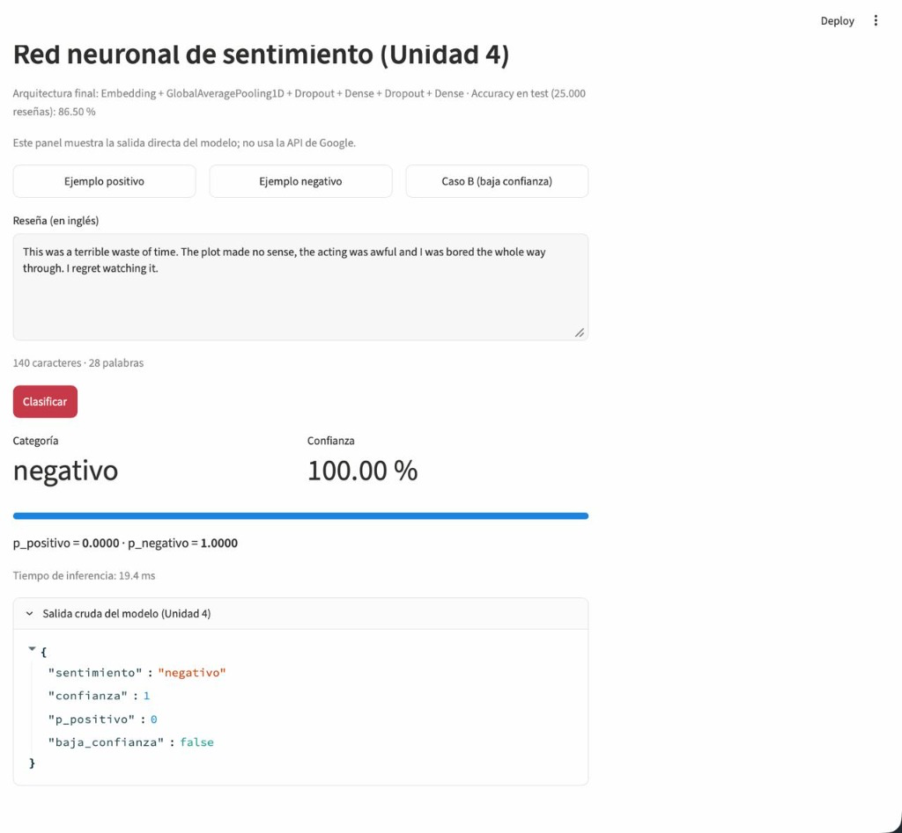

# Sistema Neuro-Agéntico de Triaje de Reseñas de Streaming (PLN + Agente ReAct)

Repositorio desarrollado para el **Taller Evaluativo Unidades 4 y 5: Sistemas Neuro-Agénticos Interactivos** — Maestría en Inteligencia Artificial Universidad de Boyacá.


## Contenido

- [Sección 1 · Identificación, Ruta y Propuesta de Valor](#sección-1--identificación-ruta-y-propuesta-de-valor)
  - [1.1 Integrantes, Ruta y Dataset](#11-integrantes-ruta-y-dataset)
  - [1.2 Distribución de Responsabilidades y Componentes Desarrollados](#12-distribución-de-responsabilidades-y-componentes-desarrollados)
  - [1.3 Propuesta de Valor del Sistema Neuro-Agéntico](#13-propuesta-de-valor-del-sistema-neuro-agéntico)
- [Sección 2 · Arquitectura del Sistema (Diagrama Propio)](#sección-2--arquitectura-del-sistema-diagrama-propio)
  - [2.1 Diagrama de Arquitectura](#21-diagrama-de-arquitectura)
  - [2.2 Especificación de la Arquitectura en Mermaid](#22-especificación-de-la-arquitectura-en-mermaid)
  - [2.3 Explicación de la Arquitectura](#23-explicación-de-la-arquitectura)
- [Sección 3 · Ingeniería del Modelo de Red Neuronal (Unidad 4) y Análisis de un Fallo Real](#sección-3--ingeniería-del-modelo-de-red-neuronal-unidad-4-y-análisis-de-un-fallo-real)
  - [3.1 Datos y preprocesamiento](#31-datos-y-preprocesamiento)
  - [3.2 Arquitectura e hiperparámetros](#32-arquitectura-e-hiperparámetros)
  - [3.3 Curvas de entrenamiento vs. validación](#33-curvas-de-entrenamiento-vs-validación)
  - [3.4 Comparación en el conjunto de prueba](#34-comparación-en-el-conjunto-de-prueba)
  - [3.5 Análisis de un fallo real](#35-análisis-de-un-fallo-real)
- [Sección 4 · Diseño del Agente y Matriz de Evaluación (Unidad 5)](#sección-4--diseño-del-agente-y-matriz-de-evaluación-unidad-5)
  - [4.1 Las Dos Herramientas](#41-las-dos-herramientas)
  - [4.2 Docstrings](#42-docstrings)
  - [4.3 Memoria y `thread_id`](#43-memoria-y-thread_id)
  - [4.4 Cuidado de Tokens y Cuota](#44-cuidado-de-tokens-y-cuota)
  - [4.5 Matriz de Evaluación](#45-matriz-de-evaluación)
- [Sección 5 · Bitácora de Vibe Coding y Razonamiento Crítico](#sección-5--bitácora-de-vibe-coding-y-razonamiento-crítico)
  - [5.1 Registro de Episodios](#51-registro-de-episodios)
  - [5.2 Evidencia General de Uso de IA](#52-evidencia-general-de-uso-de-ia)
  - [5.3 Reflexiones del Equipo](#53-reflexiones-del-equipo)
- [Sección 6 · Demostración de la Interfaz (Streamlit)](#sección-6--demostración-de-la-interfaz-streamlit)
  - [Galería de Evidencias de la Aplicación](#galería-de-evidencias-de-la-aplicación)
  - [Video Demostrativo](#video-demostrativo)
- [Sección 7 · Guía de Instalación y Ejecución Reproducible](#sección-7--guía-de-instalación-y-ejecución-reproducible)
  - [7.1 Requisitos Previos](#71-requisitos-previos)
  - [7.2 Clonación y Configuración del Entorno Virtual](#72-clonación-y-configuración-del-entorno-virtual)
  - [7.3 Instalación de Dependencias](#73-instalación-de-dependencias)
  - [7.4 Configuración de Variables de Entorno](#74-configuración-de-variables-de-entorno)
  - [7.5 Pesos del Modelo Neuronal](#75-pesos-del-modelo-neuronal)
  - [7.6 Ejecución de la Aplicación Streamlit](#76-ejecución-de-la-aplicación-streamlit)
  - [7.7 Ejecución de los Notebooks de Evaluación](#77-ejecución-de-los-notebooks-de-evaluación)
  - [7.8 Ejecución de la Suite de Pruebas Automatizadas](#78-ejecución-de-la-suite-de-pruebas-automatizadas)

## Estructura del Repositorio

```text
TallerIA/
├── README.md                       # Informe técnico (7 secciones)
├── requirements.txt                # Dependencias fijadas
├── .env.example                    # Plantilla: GOOGLE_API_KEY=tu_clave_aqui
├── .gitignore                      # Excluye .env, .venv, __pycache__, etc.
├── app.py                          # Aplicación Streamlit (red neuronal + agente)
├── src/
│   ├── config.py                   # Constantes (SEQ_LEN, umbral, modelo Gemini)
│   ├── preprocesamiento.py         # Limpieza de texto
│   ├── inferencia.py               # Carga del modelo y predicción (U4)
│   ├── tool_sentimiento.py         # @tool #1: clasificar_sentimiento_resena
│   ├── tool_politicas.py           # @tool #2: consultar_politica_triaje
│   ├── herramientas.py             # Registro de las dos herramientas
│   ├── agente.py                   # Agente ReAct + MemorySaver + thread_id
│   ├── evaluacion.py               # Trayectoria y resultado (tool_calls)
│   ├── medicion_tokens.py          # Medición de tokens antes vs. después
│   └── prueba_*.py                 # Pruebas automatizadas
├── notebooks/
│   ├── entrenamiento_u4.ipynb      # Entrenamiento y comparación (U4)
│   └── evaluacion_agente_u5.ipynb  # Evaluación del agente, 4 casos (U5)
├── models/
│   └── sentimiento_imdb.keras      # Pesos exportados
└── assets/                         # Gráficas, capturas de la app y evidencias de Vibe Coding
    ├── curvas_*.png, matriz_*.png  # Gráficas generadas por entrenamiento_u4.ipynb
    ├── diagramas/                  # Diagrama de arquitectura
    ├── capturas/
    │   ├── panel_neuronal/         # Capturas del panel de la red (U4)
    │   └── agente/                 # Capturas del agente (casos 1-4 y memoria)
    ├── apuntes/                    # Cifras y resultados de soporte
    └── vibe_coding/                # Planes y conversaciones de IA
```


---

# Sección 1 · Identificación, Ruta y Propuesta de Valor

## 1.1 Integrantes, Ruta y Dataset
* **Juan Diego Castillo Jiménez**
* **Michael Steedwar Parra Daza**

* **Ruta de Especialización:** **Ruta 3** — Procesamiento de Lenguaje Natural (PLN) con Embeddings + Agente de Triaje Inteligente.
* **Dataset Utilizado:** [`stanfordnlp/imdb`](https://huggingface.co/datasets/stanfordnlp/imdb) (Large Movie Review Dataset: 25,000 reseñas en `train`, 25,000 en `test`).

---

## 1.2 Distribución de Responsabilidades y Componentes Desarrollados

| Integrante | Componentes Desarrollados | Entregables y Módulos Técnicos |
|---|---|---|
| **Michael Steedwar Parra Daza** | • Ingeniería y preparación de datos IMDB.<br>• Modelado neuronal (Modelo Base vs. Mejorado con Dropout).<br>• Análisis de curvas de entrenamiento y matrices de confusión.<br>• Análisis empírico del fallo real (Caso B).<br>• Exportación y validación de pesos `.keras`.<br>• `@tool #1` (clasificación con red local).<br>• Interfaz visual: Panel de Inferencia Neuronal Directa.<br>• Casos 1 y 2 de evaluación del agente. | `notebooks/entrenamiento_u4.ipynb`<br>`models/sentimiento_imdb.keras`<br>`src/preprocesamiento.py`<br>`src/inferencia.py`<br>`src/tool_sentimiento.py`<br>`assets/apuntes/cifras_modelo.md`<br>`assets/apuntes/fallo_real.md` |
| **Juan Diego Castillo Jiménez** | • Estructura base del repositorio y control de versiones.<br>• `@tool #2` (políticas de triaje y protocolos de escalamiento).<br>• Agente ReAct con LangChain/LangGraph y Google AI Studio.<br>• Gestión de memoria de sesión por `thread_id` (`MemorySaver`).<br>• Medidas de optimización de tokens y control de rate limits.<br>• Integración y orquestación neuro-agéntica.<br>• Interfaz visual: Panel del Agente de Triaje con memoria.<br>• Casos 3 y 4 de evaluación del agente.<br>• Fusión de componentes y verificación de reproducibilidad. | `src/config.py`<br>`src/herramientas.py`<br>`src/tool_politicas.py`<br>`src/agente.py`<br>`src/evaluacion.py`<br>`notebooks/evaluacion_agente_u5.ipynb`<br>`app.py`<br>`assets/apuntes/medicion_tokens.md`<br>`assets/apuntes/matriz_evaluacion.md` |

---

## 1.3 Propuesta de Valor del Sistema Neuro-Agéntico

Justificación y Propuesta de Valor

En un entorno empresarial real (como una plataforma de streaming que procesa miles de reseñas al día), delegar cada clasificación de sentimiento a un LLM comercial mediante prompts directos resulta inviable. En primer lugar, genera un costo financiero acumulativo insostenible por cada token procesado. En segundo lugar, introduce una latencia de red variable, y en tercer lugar, los LLMs son modelos generativos estocásticos que carecen de una calibración de probabilidad determinista y transparente para clasificaciones binarias cerradas.

Para resolver esa ineficiencia implementamos una red neuronal ligera y especializada (`Embedding` + `GlobalAveragePooling1D` + `Dense` con Dropout en Keras 3). Esta red ofrece tres ventajas operativas contundentes: opera localmente con un costo marginal de $0, ejecuta la inferencia de forma local sin depender de la red y produce una probabilidad matemática calibrada entre 0.0 y 1.0 evaluada con rigor sobre 25,000 reseñas de prueba, alcanzando una exactitud del 86.50%.

Sin embargo, la red neuronal por sí sola es "ciega" a la lógica de negocio: solo emite un número y no puede redactar respuestas empáticas, desconocer protocolos de atención, ni recordar interacciones previas. Es aquí donde el agente ReAct se vuelve indispensable: actúa como el operador inteligente que interpreta la certeza de la red, decide si el caso exige un ticket prioritario de insatisfacción (`POL_NEG`), un registro de promotor (`POL_POS`) o derivar a moderación humana si la confianza cae por debajo del 70% (`POL_REV`). Esta sinergia neuro-agéntica divide el trabajo de forma óptima: la red local absorbe la carga pesada de clasificación en milisegundos a costo cero, mientras el agente aporta razonamiento, memoria y gobernanza de negocio con un consumo mínimo de recursos (respaldado por un ahorro del 33.9% en tokens y un 100% de cumplimiento en las pruebas de evaluación).


---

# Sección 2 · Arquitectura del Sistema (Diagrama Propio)

## 2.1 Diagrama de Arquitectura



## 2.2 Especificación de la Arquitectura en Mermaid



## 2.3 Explicación de la Arquitectura

Explicación de la Arquitectura

Para explicar la arquitectura primero explicamos el flijo del proyecto, primero el usuario por medio de nuestra interfaz hecha con Streamlit envía una consulta o una reseña. Luego el agente que está basado en un grafo ReAct recibe el mensaje del usuario. Antes de que el agente procese la solicitud se aplica un filtro de contexto que conserva 8 mensajes recientes que hace que se garantice que el modelo opere de forma ágil sin saturar su límite de tokens sin que se rompa como la idea del dialogo. Aclaramos que si el mensaje contiene una reseña que no ha sido evaluada el agente activa la herramienta de sentimiento, la cual limpia el texto y ejecuta nuestra red neuronal local, obteniendo una predicción compacta con su nivel de certeza. Luego el agente toma ese resultado y llama la herramienta de políticas corporativas para asignar el protocolo correspondiente que puede ser entre atención estándar, ticket prioritario o revisión humana. Finalmente se resume todo en una respuesta clara para el usuario, permitiendo auditar en pantalla las herramientas utilizadas y el consumo de recursos.

Una decisión importante de diseño que se tomó fue la de encapsular la red neuronal como una herramienta independiente, en lugar de conectarla directamente a la pantalla del chat. Esto lo hicimos porque se otorga autonomía al agente para que tome decisiones de cuándo es realmente necesario clasificar texto. Si un usuario simplemente saluda o pregunta por una política general, el agente responde directamente sin gastar recursos de cómputo en la red local.

Asimismo, la memoria conversacional previene re-ejecuciones innecesarias. Si en turnos posteriores el usuario realiza preguntas de seguimiento (por ejemplo, ¿cuál fue la confianza de esa reseña?), el agente consulta directamente la información almacenada en el historial de la sesión y responde de memoria, sin tener que volver a evaluar el texto en la red neuronal ni duplicar consultas a las herramientas.


---

# Sección 3 · Ingeniería del Modelo de Red Neuronal (Unidad 4) y Análisis de un Fallo Real

## 3.1 Datos y preprocesamiento

| Partición | Reseñas | Negativas | Positivas |
|---|---:|---:|---:|
| Train final | 20.000 | 10.000 | 10.000 |
| Validación | 5.000 | 2.500 | 2.500 |
| Test | 25.000 | 12.500 | 12.500 |

| Dato de preprocesamiento | Valor |
|---|---:|
| `MAX_TOKENS` / vocabulario real | 20.000 / 20.000 |
| `MAX_LEN` | 585 |
| Longitud p95 de `train_final` | 585,0 tokens |
| Reseñas de `train_final` truncadas | 4,96% |
| `SEED` | 42 |

Análisis de datos y preprocesamiento

Las reseñas tienen longitudes muy distintas entre sí, la mitad tiene menos de 172 tokens, el promedio está en 230 y la más larga llega a 2.459, lo que nos dice que hay unas pocas reseñas muy largas que estiran la distribución, si hubiéramos usado el máximo casi todas las secuencias quedarían llenas de ceros de relleno y si hubiéramos usado la mediana cortaríamos la mitad de las reseñas, por eso elegimos el percentil 95 como longitud de secuencia (SEQ_LEN = 585), un tamaño razonable que deja completo el 95% de las reseñas.

Con ese límite el 4,96% de las reseñas de train_final, unas 990, pasa de los 585 tokens, en esos casos TextVectorization se queda con los primeros 585 y descarta el resto, así que podemos perder el cierre de la reseña, que a veces es justo donde el autor da su veredicto, lo aceptamos porque es un porcentaje bajo, y en el caso contrario, el de las reseñas cortas, el relleno no altera el resultado porque usamos mask_zero=True y el promedio ignora esas posiciones vacías.

El vocabulario se construyó únicamente con train_final, así que no hay fuga de datos, y el notebook lo respalda de tres formas, en la celda 18 lo único que recibe adapt() es textos_adapt = texts_train, en la celda 25 la auditoría verifica con asserts que textos_adapt is texts_train y que los índices de entrenamiento y validación no se cruzan y además el porcentaje de palabras desconocidas [UNK] aumenta a medida que nos alejamos del entrenamiento (3,291% en train, 3,638% en validación y 4,043% en test), que es justo lo que se espera si validación y test nunca participaron en el ajuste, por último las tres particiones quedaron balanceadas 50/50 y el split unsupervised no se usó.

## 3.2 Arquitectura e hiperparámetros

| Hiperparámetro | Modelo base | Modelo mejorado |
|---|---:|---:|
| Embedding | 32 | 32 |
| Pooling | `GlobalAveragePooling1D` | `GlobalAveragePooling1D` |
| Capa densa | 16, ReLU | 16, ReLU |
| Dropout | No aplica | 0,5 (dos capas) |
| Optimizador / learning rate | Adam / 0,001 | Adam / 0,001 |
| Pérdida / métrica | `binary_crossentropy` / `accuracy` | `binary_crossentropy` / `accuracy` |
| Batch / épocas | 64 / 10 | 64 / 10 |
| Parámetros totales | 640.545 | 640.545 |

Análisis de la arquitectura e hiperparámetros

Cada reseña ya limpia pasa primero por TextVectorization, que la convierte en una secuencia de 585 números, uno por palabra, luego el Embedding transforma cada número en un vector de 32 valores que representa el significado de esa palabra, después GlobalAveragePooling1D promedia los vectores de las palabras reales y deja un solo vector de 32 por reseña, ese vector pasa por una capa Dense de 16 neuronas con ReLU y finalmente por una neurona con sigmoide que entrega la probabilidad de que la reseña sea positiva, entre los dos modelos solo cambiamos una cosa, al mejorado le agregamos dos capas Dropout de 0,5, una después del pooling y otra después de la capa densa, todo lo demás se mantuvo igual (vocabulario, longitud, embedding, capa densa, Adam con learning rate de 0,001, batch, épocas y semilla 42), de esta forma cualquier diferencia en los resultados se le puede atribuir únicamente a la regularización.

Los dos modelos tienen 640.545 parámetros porque Dropout no tiene pesos que aprender, durante el entrenamiento solo apaga neuronas al azar y al momento de predecir no hace nada, la cuenta sale del Embedding con 20.000 × 32 = 640.000, la capa densa con 32 × 16 + 16 = 528 y la salida con 16 + 1 = 17, lo que muestra que el embedding concentra el 99,9% de los parámetros y que la capacidad del modelo está en cómo representa las palabras y no en las capas densas.

## 3.3 Curvas de entrenamiento vs. validación


Análisis de las curvas de entrenamiento vs. validación

En el modelo base el val_loss baja hasta la época 4, donde llega a su mínimo de 0,2585, y a partir de la época 5 empieza a subir hasta 0,3734 en la época 10 (+0,1149), mientras tanto el loss de entrenamiento sigue bajando hasta 0,0274, así que desde la época 5 las curvas se separan y el modelo empieza a memorizar los datos de entrenamiento en lugar de aprender a generalizar, generando sobreajuste, el modelo mejorado también alcanza su mejor punto en la época 4 con un val_loss de 0,2584, pero después sube bastante menos (+0,0835, hasta 0,3418) y su loss de entrenamiento termina más alto (0,0770), lo que indica que el Dropout sí logra frenar la memorización. La brecha de accuracy entre entrenamiento y validación confirma lo mismo, en la época 4 es de 0,0473 en el base (0,9481 − 0,9008) y de 0,0285 en el mejorado (0,9277 − 0,8992), y para la época 10 crece a 0,1054 en el base (0,9968 − 0,8914) frente a 0,0863 en el mejorado (0,9807 − 0,8944), es decir, con Dropout la distancia entre lo que el modelo logra en entrenamiento y lo que logra con datos nuevos siempre es menor.

En conclusión el Dropout reduce el sobreajuste pero no lo elimina, ambos modelos empiezan a sobreajustarse después de la época 4, que sería el punto ideal para detener el entrenamiento (con early stopping nos habríamos quedado con esos pesos) y vale aclarar que el accuracy de entrenamiento del modelo mejorado se mide con el Dropout activo, por eso su curva de entrenamiento se ve un poco más baja de lo que realmente es.

## 3.4 Comparación en el conjunto de prueba

| Modelo | Test loss | Test accuracy | Mejor `val_loss` | Época mejor `val_loss` |
|---|---:|---:|---:|---:|
| Base | 0,4638 | 0,8596 | 0,2585 | 4 |
| Mejorado (Dropout) | 0,4198 | 0,8650 | 0,2584 | 4 |




| Matriz `[[TN, FP], [FN, TP]]` | Valor |
|---|---|
| Modelo base | `[[11010, 1490], [2020, 10480]]` |
| Modelo mejorado | `[[11149, 1351], [2024, 10476]]` |

Análisis de la comparación en el conjunto de prueba

En el conjunto de prueba el modelo mejorado gana 0,54 puntos de accuracy (de 0,8596 a 0,8650), que en la práctica son 135 errores menos sobre 25.000 reseñas (de 3.510 a 3.375), además su test loss baja de 0,4638 a 0,4198, lo que quiere decir que cuando se equivoca lo hace con menos exceso de confianza, es una mejora real aunque pequeña, al comparar las matrices de confusión se ve que casi toda la mejora está en los falsos positivos, que bajan de 1.490 a 1.351 (139 menos), mientras los falsos negativos quedan prácticamente iguales de 2.020 a 2.024, esto es útil para el triaje porque cuando el modelo dice positivo acierta más y la precisión pasa de 87,6% a 88,6% y se nos escapan menos quejas reales clasificadas como felicitaciones, también se nota que ambos modelos se equivocan más leyendo reseñas positivas como negativas (cerca de 2.020) que al revés, lo que genera tickets de insatisfacción innecesarios, pero ese es el error menos grave para el negocio.

Los 3.375 errores del modelo mejorado son exactamente la suma de sus falsos positivos y falsos negativos (1.351 + 2.024) y ninguno cae en los 99 textos que se repiten entre train y test, así que esos duplicados no inflan el resultado, por otro lado el accuracy en test (0,8650) queda unos 3 puntos por debajo del de validación en la misma época 10 (0,8944), algo esperable porque la validación salió del mismo split de entrenamiento y comparte películas con él, mientras que en IMDB el test está formado por películas distintas y además trae más palabras desconocidas (4,04% frente a 3,64% en validación).

## 3.5 Análisis de un fallo real

| Campo | Dato exacto |
|---|---|
| Modelo / conjunto | Mejorado (Dropout) / test |
| `idx_test` | 5220 |
| Valor real | 0 (negativo) |
| Predicción | 1 (positivo) |
| Probabilidad de clase positiva | 1,000000 |
| Confianza en la clase predicha | 1,000000 |
| Tipo | Falso positivo |
| Fragmento literal | `Primary plot!Primary direction!Poor interpretation.` |
| Fuente | `notebooks/entrenamiento_u4.ipynb`, celda 58 |

Análisis del fallo real

Al ejecutar el modelo encontramos que el fallo nace en el preprocesamiento y no en la red, la limpieza borra los signos de puntuación sin dejar un espacio en su lugar, así que el texto termina convertido en primary plotprimary directionpoor interpretation, las palabras pegadas plotprimary y directionpoor no existen y se vuelven [UNK], de modo que el modelo solo ve primary, [UNK], [UNK] e interpretation, y la palabra poor, que es la que carga todo el sentido negativo, desaparece antes de llegar a la red aunque sí está en el vocabulario, lo comprobamos con dos pruebas sencillas, el mismo texto con un espacio después de cada signo de exclamación da negativo con confianza 1,0 y la frase poor interpretation sola también da negativo con 1,0, por eso la explicación inicial de que el modelo le dio demasiado peso a primary se queda corta, el problema real es que nunca llegó a ver la palabra poor, el modelo asignó una probabilidad positiva de 1,000000 a una reseña que en realidad es negativa, es decir, se equivocó con certeza absoluta, y esto pasa porque en una reseña tan corta el promedio del pooling depende de solo dos o tres palabras, lo que hace que la sigmoide se sature en 0 o en 1 (por ejemplo la palabra primary sola ya da 1,0).

Para el triaje este caso es delicado porque el umbral de baja confianza de 0,70 no lo detecta, el agente lo trataría como un positivo seguro (POL_POS) y nunca lo enviaría a revisión humana, lo que demuestra que una confianza alta no garantiza una predicción correcta, como mejora convendría reemplazar la puntuación por un espacio en lugar de borrarla y tratar con más cuidado las reseñas muy cortas.

# Sección 4 · Diseño del Agente y Matriz de Evaluación (Unidad 5)

## 4.1 Las Dos Herramientas

El agente dispone de dos herramientas especializadas con responsabilidades no superpuestas:

1. **`@tool #1: clasificar_sentimiento_resena`** ([src/tool_sentimiento.py](src/tool_sentimiento.py)):
   ```python
   @tool
   def clasificar_sentimiento_resena(texto: str) -> str:
       """Clasifica sentimiento de resena en ingles usando red neuronal.

       Usala: usuario entrega texto de resena para clasificar.
       NO usar: saludos, preguntas de politicas o texto ya clasificado.

       Args:
           texto: resena literal en ingles.

       Returns:
           JSON (max 120 chars) con sentimiento, confianza y baja_confianza.
       """
   ```

2. **`@tool #2: consultar_politica_triaje`** ([src/tool_politicas.py](src/tool_politicas.py)):
   ```python
   @tool
   def consultar_politica_triaje(consulta: str, sentimiento: str = None, confianza: float = None) -> str:
       """Consulta la politica interna y protocolo de respuesta para una resena de cliente.

       Usala cuando conozcas el sentimiento/confianza de la resena o cuando el usuario pregunte
       directamente sobre lineamientos, politicas de triaje o protocolos de escalamiento.
       NO la uses para clasificar texto no analizado (usa clasificar_sentimiento_resena) ni
       para saludos o preguntas genericas no relacionadas con politicas.

       Args:
           consulta: pregunta o texto de consulta sobre el protocolo o la resena.
           sentimiento: 'positivo', 'negativo' o 'incierto' (si ya fue inferido).
           confianza: valor flotante de certeza (0.0 a 1.0).

       Returns:
           JSON compacto (max 600 caracteres) con pol_id, prioridad, accion y pauta.
       """
   ```

Análisis de Diseño de Herramientas

En la elavoracion del trabajo tuvimos que tener en cuenta que para que la herramienta del sentimiento no se ejecute innecesariamente más de una vez sobre el mismo texto implementamos una barrera técnica. En primer lugar, el prompt del sistema y el docstring de la herramienta contienen instrucciones explícitas de exclusión que le prohíben al agente re-clasificar contenido ya procesado en la conversación. En segundo lugar, gracias a la memoria conversacional, el agente revisa el historial y detecta si ya existe una predicción previa guardada. Al confirmar que ya cuenta con el veredicto de la red neuronal, el agente salta directamente al siguiente paso (consultar la política o responder), ahorrando tiempo y evitando sobrecostos de procesamiento.

También, la herramienta de políticas de triaje fue diseñada como opcional. Esto lo hicimos porque se desacopla la herramienta y le permite operar en dos escenarios muy distintos: 1. Flujo guiado por el modelo neuronal: Cuando se analiza una reseña completa, el agente envía el sentimiento y la confianza numérica devueltos por la primera herramienta, permitiendo que la política aplique reglas lógicas de certeza (activando de inmediato la revisión humana si la confianza cae por debajo del 70%). 2. Consulta normativa directa: Si un usuario o supervisor pregunta directamente por un protocolo interno (por ejemplo: ¿qué política aplica si un cliente amenaza con demandar?), no existe una reseña previa ni cifras de confianza. Al ser opcionales, la herramienta no falla ni fuerza al agente a inventar datos; simplemente busca en el catálogo de reglas mediante palabras clave y devuelve la política correspondiente.

## 4.2 Docstrings

Los docstrings actúan como el manual de operaciones del planificador del LLM. Su diseño optimizado incluye directrices explícitas de activación positiva (`Usala:`) y exclusión negativa (`NO usar:`).

Impacto Operativo de los Docstrings

Encontramos que en los agentes basados en LLM, uno de los errores más comunes es la sobre-activación de herramientas que básicamente es cuando el agente se vuelve ansioso y ejecuta herramientas ante cualquier saludo casual. Para mitigar esto, estructuramos los docstrings bajo una lógica de directrices positivas (Usala cuando...) y exclusiones negativas taxativas (NO usar...). La frase determinante en la primera herramienta fue:

`NO usar: saludos, preguntas de politicas o texto ya clasificado.`

Gracias a esta instrucción prohibitiva explícita, en el Caso 1 de evaluación el agente reconoció que ante un mensaje de cortesía (Hola, ¿en qué me puedes ayudar?) no debía invocar la red neuronal, respondiendo de inmediato con una lista vacía de herramientas y consumiendo el mínimo de recursos

Entre la Tarea 6 y la Tarea 8 realizamos una depuración profunda en la redacción de los docstrings. Inicialmente eran textos descriptivos que explicaban detalles internos del modelo (como capas o librerías), lo que confundía al planificador y provocaba llamadas desordenadas o duplicadas. Al sintetizarlos como contratos operativos concisos, eliminamos las alucinaciones y delimitamos claramente la frontera entre ambas herramientas: la Tool #1 solo analiza reseñas no clasificadas y la Tool #2 solo atiende reglas y políticas de triaje.

Esta optimización tuvo además un impacto cuantitativo directo en el consumo de contexto. Dado que la definición de las herramientas se concatena y reenvía al modelo en cada paso intermedio del razonamiento, compactar el docstring de la Tool #1 (de 122 a 122 tokens, un 0.0% de ahorro) y el de la Tool #2 (de 205 a 187 tokens, un 8.8% de ahorro) redujo el consumo acumulado de tokens de entrada en turnos complejos de doble llamada.

## 4.3 Memoria y `thread_id`

La memoria conversacional del agente se gestiona a través de un checkpointer volátil en memoria (`MemorySaver`), aislando las sesiones mediante `thread_id`.

### 1. Creación del Checkpointer y Compilación del Agente ([src/agente.py](src/agente.py))
```python
checkpointer = MemorySaver()
agente = create_agent(
    model=llm,
    tools=tools,
    system_prompt=SYSTEM_PROMPT_COMPACTO,
    middleware=[crear_middleware_recorte(MAX_MENSAJES_HISTORIAL)],
    checkpointer=checkpointer,
)
```

### 2. Configuración y Generación de Sesión ([src/agente.py](src/agente.py))
```python
def nuevo_thread_id() -> str:
    """Genera un nuevo identificador de sesión único (UUID4)."""
    return str(uuid.uuid4())


def config_sesion(thread_id: str) -> Dict[str, Any]:
    """Retorna la configuración requerida por LangGraph para direccionar la sesión."""
    return {"configurable": {"thread_id": thread_id}}
```

### 3. Reinicio de Sesión en la Aplicación ([app.py](app.py))
```python
if st.button("🔄 Reiniciar conversación", help="Genera un nuevo thread_id y vacía el historial de pantalla"):
    st.session_state.ag_thread_id = nuevo_thread_id()
    st.session_state.ag_historial = []
    st.rerun()
```

Explicación de la Memoria y Reinicio

Para validar el comportamiento de la memoria conversacional implementamos dos pruebas. En la primera prueba tras clasificar una reseña en un hilo activo, le preguntamos al agente en el siguiente turno: ¿cuál fue la confianza de esa reseña?. El agente respondió con la cifra exacta devuelta por la red neuronal recuperándola directamente del historial del checkpointer sin necesidad de volver a ejecutar la herramienta. Posteriormente, en la segunda prueba que hicimops generamos un nuevo hilo y repetimos la misma pregunta; el agente respondió indicando que no contaba con contexto previo y verificamos que el nuevo hilo iniciaba en blanco, demostrando un borrado y aislamiento perfecto entre sesiones.

Finalmente, para evitar desbordamientos de contexto y sobrecostos en conversaciones extensas, implementamos un recorte dinámico de historial de esta manera restringiendo la memoria a una ventana móvil de los 8 mensajes más recientes y preservando siempre el prompt del sistema. En este mecanismo, configurar el parámetro `allow_partial=False` fue un requisito crítico para la API de Gemini: si un recorte divide un mensaje del agente con llamadas a herramientas (AIMessage.tool_calls) y deja huérfano su correspondiente mensaje de respuesta (ToolMessage), Google AI Studio rechaza la petición con un error 400 (Bad Request). Al exigir `allow_partial=False`, LangChain solo descarta bloques completos de interacción, garantizando estabilidad total en turnos prolongados.

---

## 4.4 Cuidado de Tokens y Cuota

Para operar de forma sostenible dentro de la capa gratuita de Google AI Studio (15 RPM), se implementaron 9 medidas de optimización técnica:

| # | Medida de Ahorro | Ubicación en Código | Efecto Medido / Cifra Empírica |
|---|---|---|---|
| 1 | **System prompt compacto (6 directrices)** | [src/agente.py](src/agente.py) | De **395** a **136 tokens** (**65.6% de ahorro**) |
| 2 | **Docstring compacto Tool #1** | [src/tool_sentimiento.py](src/tool_sentimiento.py) | De **122** a **122 tokens** (**0.0% de ahorro**) |
| 3 | **Docstring compacto Tool #2** | [src/tool_politicas.py](src/tool_politicas.py) | De **205** a **187 tokens** (**8.8% de ahorro**) |
| 4 | **Límite duro de caracteres en Tool #1** | [src/tool_sentimiento.py](src/tool_sentimiento.py) | Assert `len(salida) <= 120` (salida real: **66 chars**) |
| 5 | **Límite duro de caracteres en Tool #2** | [src/tool_politicas.py](src/tool_politicas.py) | Assert `len(salida) <= 600` (salida real: **156 chars**) |
| 6 | **Tope de generación (`max_output_tokens`)** | [src/agente.py](src/agente.py) | Limitado a **512 tokens** con `temperature=0` |
| 7 | **Recorte dinámico de historial (`trim_messages`)** | [src/agente.py](src/agente.py) | Ventana máxima de **8 mensajes** recientes (`MAX_MENSAJES_HISTORIAL`) |
| 8 | **Límite de ritmo (`InMemoryRateLimiter`)** | [src/agente.py](src/agente.py) | **0.25 req/seg** (15 RPM) para prevenir errores HTTP 429 |
| 9 | **Tope defensivo de entrada** | [src/config.py](src/config.py), [src/agente.py](src/agente.py) | Truncado automático a **4,000 caracteres** |

### Comparativa Global Antes vs. Después ([assets/apuntes/medicion_tokens.md](assets/apuntes/medicion_tokens.md))

| Caso Evaluado | Tokens Antes (In / Out / Tot) | Tokens Después (In / Out / Tot) | Ahorro Total (%) |
|---|---|---|:---:|
| **Caso 1: Saludo** | 838 / 95 / 933 | 565 / 69 / 634 | **32.0%** |
| **Caso 2: Pregunta de política** | 2,007 / 151 / 2,158 | 1,401 / 98 / 1,499 | **30.5%** |
| **Caso 3: Reseña completa** | 3,835 / 199 / 4,034 | 2,420 / 159 / 2,579 | **36.1%** |
| **TOTAL SUITE (3 turnos)** | **6,680 / 445 / 7,125** | **4,386 / 326 / 4,712** | **33.9%** |

Justificación de las Medidas de Ahorro

De las 9 medidas implementadas, la que generó el mayor impacto cuantitativo fue la compresión del System Prompt, el cual redujimos de 395 a solo 136 tokens (un ahorro neto del 65.6%). La razón de su enorme impacto radica en el efecto multiplicador del ciclo ReAct: mientras que los mensajes del usuario o las salidas de las herramientas solo se envían en su respectivo turno, el prompt del sistema se inyecta como prefijo obligatorio en absolutamente todas las llamadas que se hacen al LLM. En un flujo completo donde el agente primero planifica, luego invoca la Tool #1, después la Tool #2 y finalmente redacta la respuesta, el system prompt se reenvía hasta tres o cuatro veces en un solo turno de conversación. Reducir 259 tokens en esa plantilla base se traduce en miles de tokens ahorrados a lo largo de una sesión.

Para lograr esta reducción sin comprometer el comportamiento del agente eliminamos las cosas que no aportaban como la prosa, los fomralismos innecesarios y las explicaciones pedagógicas extensas. En cambio de eso resumimos las instrucciones bajo una sintaxis imperativa y contractual organizada en seis directrices estrictas: rol de triaje, prohibición de re-clasificar, condición de activación de la Tool #1, flujo de argumentos hacia la Tool #2, formato mínimo de respuesta al usuario y mandato de no corregir a la red neuronal en casos de incertidumbre. Este diseño de alta densidad semántica garantizó que el agente mantuviera un 100% de cumplimiento operativo utilizando únicamente una fracción del contexto original.

Esta estrategia se complementó con límites duros en las salidas de las herramientas, obligándolas a devolver JSON compacto en una sola línea que consume un espacio mínimo en el historial. Asimismo, implementamos un limitador de ritmo en memoria a 0.25 peticiones por segundo blindando a la aplicación contra bloqueos por error HTTP 429 en la capa gratuita de Gemini. Por último, en el recorte de historial con trim_messages, el parámetro allow_partial=False fue vital: garantizó que al ahorrar tokens jamás se descartaran mensajes a medias, evitando romper la pareja indivisible entre la llamada a la herramienta y su resultado, lo que habría provocado un fallo de validación en la API. En conjunto, estas medidas lograron un ahorro global medido del 33.9% en la suite de evaluación (reduciendo de 7,125 a 4,712 tokens).
---

## 4.5 Matriz de Evaluación

Resultados reproducibles extraídos de [notebooks/evaluacion_agente_u5.ipynb](notebooks/evaluacion_agente_u5.ipynb) (Celda 12, In[6]):

| Caso | Entrada Resumida | Herramientas Esperadas | Herramientas Invocadas | Trayectoria | Resultado | Tokens Medidos |
|:---|:---|:---|:---|:---:|:---:|---:|
| **Caso 1** (Celda In[2]) | `Hola, ¿qué puedes hacer por mí?` | `[]` | `[]` | **CUMPLE** | **CUMPLE** | 609 |
| **Caso 2** (Celda In[3]) | `¿Qué política debo aplicar si un cliente amenaza c...` | `consultar_politica_triaje` | `consultar_politica_triaje` | **CUMPLE** | **CUMPLE** | 1,365 |
| **Caso 3** (Celda In[4]) | `Haz el triaje de esta reseña de un cliente: "Widow...` *(idx_test: 41)* | `clasificar_sentimiento_resena, consultar_politica_triaje` | `clasificar_sentimiento_resena, consultar_politica_triaje` | **CUMPLE** | **CUMPLE** | 2,230 |
| **Caso 4** (Celda In[5]) | `Haz el triaje de esta reseña de un cliente: "Not b...` *(Caso B)* | `clasificar_sentimiento_resena, consultar_politica_triaje` | `clasificar_sentimiento_resena, consultar_politica_triaje` | **CUMPLE** | **CUMPLE** | 2,130 |

- **Casos con trayectoria correcta sobre el total:** 4 de 4 (**100.0%**)
- **Casos con resultado correcto sobre el total:** 4 de 4 (**100.0%**)
- **Validación de trayectoria:** Determinada exclusivamente desde `AIMessage.tool_calls` a través de `herramientas_invocadas` en `src/agente.py` y verificada en `src/evaluacion.py`. Cero inspecciones sobre la respuesta final de texto.

Análisis de la Matriz de Evaluación

La diferencia entre el caso 1 y el caso 2 demuestra la capacidad de discriminación del agente, en el caso 1 'Hola, ¿qué puedes hacer por mí?', el agente identificó un simple saludo de bienvenida y respondió cordialmente sin activar ninguna herramienta de esta manera consumiendo un mínimo de tokens de apenas 609. En cambio, en el caso 2 '¿Qué política debo aplicar si un cliente amenaza con demandar?' reconoció una consulta normativa sobre protocolos de escalamiento legal y activó exclusivamente la herramienta de políticas. Esto comprueba que el agente no opera como un script rígido que dispara herramientas por reflejo, sino que planifica selectivamente según la intención del usuario, ahorrando cómputo y preservando cuota.

En el Caso 3 evaluamos el flujo neuro-agéntico completo utilizando una reseña negativa real del conjunto de prueba. El agente ejecutó de forma autónoma la secuencia requerida, primero invocó la @tool #1 para obtener la inferencia de la red local (sentimiento: 'negativo', confianza: 1.0), y acto seguido utilizó esos mismos valores como argumentos para invocar la @tool #2 (sentimiento='negative', confianza=1). La herramienta retornó la política (Ticket de insatisfacción, Prioridad Alta) y el agente estructuró una respuesta final donde comunicó fielmente tanto el sentimiento como las pautas de atención. En el notebook validamos por código mediante asserts que no existió ninguna distorsión entre lo que arrojó la red local y los argumentos recibidos por la política de triaje.

El Caso 4 (basado en el primer caso de fallo real: 'Not bad, but not great either...') puso a prueba el comportamiento ético y defensivo del sistema. La red neuronal predijo sentimiento negativo pero con una certeza de apenas 0.5835 (58.35%), quedando por debajo del umbral corporativo de seguridad (UMBRAL_BAJA_CONFIANZA = 0.70). En lugar de 'adivinar' o corregir al modelo por su cuenta, el agente respetó la directriz del sistema: comunicó abiertamente la baja confianza y aplicó la política (Derivar a moderación humana con prioridad media). En un servicio real de streaming, esta prudencia evita automatizar respuestas equivocadas ante clientes con quejas ambiguas. Finalmente, cabe destacar que todas las trayectorias se auditaron inspeccionando directamente los objetos estructurados y no leyendo texto libre, alcanzando un 100.0% de acierto tanto en trayectorias como en resultados (4 de 4 casos cumplidos).

---

# Sección 5 · Bitácora de Vibe Coding y Razonamiento Crítico

## 5.1 Registro de Episodios

Registro unificado de incidencias, errores de librerías, APIs desactualizadas y malas prácticas detectadas durante el desarrollo asistido por IA, ordenado cronológicamente:

| # | Fecha | Tarea | Integrante | Herramienta IA | Qué propuso la IA | Problema detectado | Cómo se corrigió | Evidencia en `assets/` |
|---|---|---|---|---|---|---|---|---|
| 1 | 2026-11-17 | Tarea 6 | Juan Diego | Antigravity | Usar `gemini-2.0-flash` y `gemini-2.0-flash-lite`. | Modelos dados de baja en Google AI Studio (`404 NOT_FOUND`) y respuesta como lista de dicts. | Migración a `gemini-3.5-flash-lite` y normalizador de texto en `responder()`. | La evidencia es el plan de la tarea en [plan_tarea_6.md](assets/apuntes/plan_tarea_6.md) |
| 2 | 2026-11-17 | Tarea 9 | Steedwar | Antigravity / IA | `modelo.predict(np.array([[limpio]], dtype=object))` | Keras 3 rechaza arrays `object` (`ValueError: Invalid dtype: object`). | `modelo(tf.constant([[limpio]]), training=False)`. | [episodio2.png](assets/vibe_coding/episodio2.png), captura de la conversación en Antigravity donde el episodio de `dtype=object` queda como pendiente de bitácora |
| 3 | 2026-11-17 | Tarea 10 | Juan Diego | Antigravity | Regla 5 de prompt que solo pedía *"prioridad, accion y pauta"*. | El agente omitía escribir el sentimiento ("negativo") en la respuesta al usuario, fallando el assert. | Se forzó en la regla 5 mencionar sentimiento y confianza detectados. | La evidencia es el plan de la tarea en [plan_tarea_10.md](assets/apuntes/plan_tarea_10.md) |
| 4 | 2026-11-17 | Tarea 12 | Juan Diego | Antigravity | `@patch("app_agent.responder")` en `AppTest`. | `AppTest` corre en hilo aislado e importaba de nuevo `src.agente`, llamando a la API real. | `patch.object(src.agente, "responder")` interceptando directamente el módulo origen. | La evidencia es el plan de la tarea en [plan_tarea_12.md](assets/apuntes/plan_tarea_12.md) |
| 5 | 2026-11-17 | Tarea 15 | Steedwar | Codex | Reejecutar notebook de entrenamiento para matrices de confusión. | Sobrescribió incidentalmente `models/sentimiento_imdb.keras`, violando el alcance. | Restauración de pesos desde `HEAD` y aislamiento de celda de matrices. | [episodio5.png](assets/vibe_coding/episodio5.png), captura del plan de Codex que incluye reejecutar el notebook para las matrices de confusión |





## 5.2 Evidencia General de Uso de IA

- Conversación compartida (Claude): https://claude.ai/share/e65ce0fc-e890-49b2-9be6-e96301573b1f
- Gemini integrado en Google Docs (Tarea 1, carga del dataset): [assets/vibe_coding/gemini_google_docs_tarea1.md](assets/vibe_coding/gemini_google_docs_tarea1.md)
- Plan del agente de Antigravity, Tarea 13: [assets/vibe_coding/plan_antigravity_tarea13.md](assets/vibe_coding/plan_antigravity_tarea13.md)
- Plan del agente de Antigravity, verificación Tarea 19: [assets/vibe_coding/plan_antigravity_verificacion_tarea19.md](assets/vibe_coding/plan_antigravity_verificacion_tarea19.md)
- Capturas de la conversación con Claude (generación y ajuste de los prompts de las tareas):







En la Tarea 3 usamos Claude Sonnet 5.5 desde Antigravity para generar las celdas 29 a 37 del notebook con el modelo base, la IA reutilizó las variables que ya venían de la Tarea 1 (MAX_LEN = 585, SEED y vocab) sin recalcularlas y sin tocar el conjunto de test, la evidencia está en assets/vibe_coding/vibe_coding_tarea3.md junto con sus 3 capturas.

En la Tarea 5 la misma IA construyó el modelo mejorado cambiando únicamente el Dropout, y durante la ejecución detectó un error suyo, en Keras 3.10 metrics_names devuelve loss y compile_metrics en lugar de loss y accuracy, así que tuvo que corregir el assert, la evidencia está en assets/vibe_coding/vibe_coding_tarea5.md junto con sus 5 capturas.

En la Tarea 9 la IA propuso llamar a modelo.predict pasándole un arreglo NumPy con dtype=object, algo que Keras 3 rechaza, y lo corregimos llamando al modelo con tf.constant (episodio 2 de la tabla 5.1).

En la Tarea 15 Codex volvió a ejecutar todo el notebook para generar las matrices de confusión y de paso sobrescribió los pesos sentimiento_imdb.keras, que estaban por fuera del alcance de la tarea, así que los restauramos desde HEAD (episodio 5 de la tabla 5.1).

---

## 5.3 Reflexiones del Equipo

Reflexión Crítica sobre el Modelado y Vibe Coding - Steedwar

Usar asistentes de IA con Keras 3 exige cuidado porque muchas veces proponen código pensado para Keras 2 que ahora falla o se comporta distinto, como pasar arreglos con dtype=object, confiar en metrics_names o guardar funciones de limpieza sin registrarlas con register_keras_serializable, por eso validamos cada paso con asserts contra la fuga de datos, semillas fijas, una prueba de ida y vuelta del archivo .keras (el modelo cargado en un proceso nuevo da exactamente las mismas predicciones, con diferencia máxima de 0,0) y una réplica en Python puro de la limpieza del notebook para que la inferencia sea idéntica al entrenamiento, y también aprendimos a limitar el alcance de la IA, porque Codex sobrescribió los pesos al reejecutar el notebook y lo detectamos revisando los cambios con git.

Con el caso de dtype=object la IA sugirió pasar el texto como un arreglo NumPy de tipo object y Keras 3 lo rechazó con el error ValueError Invalid dtype object, lo detectamos a tiempo porque src/prueba_inferencia.py falló desde la primera llamada, antes de que el error llegara a la aplicación o al agente, y lo corregimos llamando al modelo con tf.constant y training=False.

La lección más importante nos la dejó el fallo real, un preprocesamiento que parecía correcto terminó borrando información en silencio (se perdió la palabra poor) sin lanzar ningún error, lo que nos enseñó que un código que corre sin errores no es lo mismo que un código correcto y que siempre hay que verificar con datos reales.


Reflexión Crítica sobre el Agente y Vibe Coding - Juan Diego

Entendimos que el desarrollo asistido por modelos generativos ofrece una velocidad impresionante para prototipar, pero que introduce un riesgo el cual consta de que genera una ilusión de que el código funciona simplemente porque es visualmente correcta o no arroja errores visibles a primera vista. En arquitecturas agénticas, donde intervienen modelos probabilísticos y múltiples herramientas, los errores no siempre generan excepciones de sintaxis; a menudo se manifiestan como llamadas duplicadas a APIs, omisión de directrices o consumo excesivo de contexto. En este proyecto, la supervisión humana complementada con una batería de pruebas automatizadas y asserts estrictos donde esto nos deja como único filtro para encontrar las fallas de la IA antes de que se dañe el entorno de producción y conlleve a múltiples conflictos, y más que ser un trabajo colaborativo debíamos de entender cualquier decisión tomada.

Los incidentes documentados en nuestra bitácora evidencian los peligros que habría conllevado aceptar ciegamente las sugerencias del asistente. En primer lugar, la IA propuso utilizar el modelo gemini-2.0-flash, el cual ya se encontraba descontinuado en Google AI Studio; de no haber auditado la llamada en vivo, la aplicación habría colapsado de inmediato con un error 404 NOT_FOUND ante el evaluador. Fue necesario investigar la documentación oficial vigente, migrar a gemini-3.5-flash-lite y construir un normalizador defensivo de respuestas. En segundo lugar, al crear las pruebas de la interfaz con AppTest, la IA sugirió un decorador @patch('app_agent.responder') que resultaba inútil: como el runner de Streamlit se ejecuta en un hilo aislado, el módulo se volvía a importar en un espacio de nombres independiente, saltándose el mock y consumiendo peticiones reales a la API. De haberlo ignorado, habríamos agotado la cuota gratuita en cuestión de minutos durante las pruebas automáticas.

---

# Sección 6 · Demostración de la Interfaz (Streamlit)

Esta sección reúne las capturas de la aplicación Streamlit, primero el panel de inferencia directa de la red neuronal con cuatro casos que incluyen el fallo real del índice 5220, luego el panel del agente con los cuatro casos de evaluación y las dos pruebas de memoria por thread_id, y al final el video que recorre los mismos casos con las herramientas invocadas visibles en pantalla.

## Galería de Evidencias de la Aplicación

### 1. Inferencia Neuronal: Reseña Positiva Clara

*Figura 6.1:* Aquí se ingresa una reseña claramente positiva y el modelo neuronal la clasifica como positiva con una confianza alta, el panel muestra la etiqueta y el porcentaje de probabilidad, lo que confirma que el flujo de inferencia funciona como se esperaba.

### 2. Inferencia Neuronal: Reseña Negativa Clara

*Figura 6.2:* Aquí se ingresa una reseña claramente negativa y el modelo la clasifica como negativa con buena confianza, con este caso vemos que el modelo distingue bien ambas polaridades cuando el lenguaje es directo y no deja lugar a dudas.

### 3. Inferencia Neuronal: Detección de Baja Confianza (Caso B)

*Figura 6.3:* Aquí la reseña es ambigua y la probabilidad queda cerca del punto medio, por eso el sistema la marca como de baja confianza y recomienda una revisión humana, así se evita tomar una decisión automática sobre una predicción poco segura.

### 4. Fallo Real (Caso A): Predicción Positiva con Confianza Máxima

*Figura 6.4:* Este es el fallo real del modelo mejorado sobre el índice 5220 del conjunto de prueba, la reseña es negativa y el panel la clasifica como positiva con probabilidad de 1,0000 y confianza de 100,00 por ciento, el error no viene de sarcasmo sino del preprocesamiento que borra los signos de puntuación sin dejar espacio, pega las palabras y hace que poor llegue a la red como token desconocido, y como la confianza es máxima el umbral de 0,70 no lo detecta.

### 5. Agente — Caso 1: Saludo sin Herramientas

*Figura 6.5:* El usuario envía un simple saludo y el agente responde de forma directa sin llamar a ninguna herramienta, esto demuestra que el agente decide por sí mismo cuándo no necesita clasificar ni consultar políticas, y así ahorra llamadas innecesarias.

### 6. Agente — Caso 2: Solo Consulta de Política

*Figura 6.6:* El usuario pregunta por una política de atención y el agente usa únicamente la herramienta de consulta de políticas, sin pasar por el clasificador, la respuesta se apoya en el documento recuperado y no en información inventada por el modelo.

### 7. Agente — Caso 3: Triaje de Reseña Negativa (Clasificación → Política)

*Figura 6.7:* Ante una reseña negativa el agente encadena dos herramientas, primero clasifica el sentimiento con la red neuronal y luego consulta la política que corresponde a ese resultado, el orden de las llamadas se puede ver en el panel y la respuesta final combina ambos datos para proponer una acción.

### 8. Agente — Caso 4: Reseña de Baja Confianza (Revisión Humana)

*Figura 6.8:* El agente recibe una reseña cuya clasificación llega con baja confianza y en lugar de actuar por su cuenta la deriva a revisión humana, así se respeta la regla definida para los casos dudosos y se reduce el riesgo de una respuesta automática equivocada.

### 9. Agente — Memoria dentro del Mismo Hilo

*Figura 6.9:* Dentro del mismo hilo el usuario hace una pregunta que depende del mensaje anterior y el agente la responde correctamente, esto se logra porque el checkpointer guarda el historial asociado al mismo thread_id y lo recupera en cada turno.

### 10. Agente — Aislamiento de Memoria tras Reiniciar la Conversación

*Figura 6.10:* Después de reiniciar la conversación se genera un nuevo thread_id y el agente ya no recuerda lo dicho antes, lo que confirma que la memoria está aislada por hilo y que ninguna información de una sesión pasa a otra.

---

## Video Demostrativo

**[Ver video demostrativo (Google Drive)](https://drive.google.com/file/d/177cMiWQjCKruie1p2ZrsadWDnYiEyp7f/view?usp=sharing)**

---

# Sección 7 · Guía de Instalación y Ejecución Reproducible

Instrucciones exactas y verificadas para clonar, instalar dependencias, configurar variables de entorno y ejecutar tanto la aplicación interactiva como la suite de evaluación.

## 7.1 Requisitos Previos
* **Python:** Versión 3.10 a 3.12 (recomendado 3.12, la usada en el desarrollo).
* **Git:** Instalado en el sistema operativo.
* **Clave de API:** Cuenta en [Google AI Studio](https://aistudio.google.com/) para obtener una `GOOGLE_API_KEY` gratuita.

---

## 7.2 Clonación y Configuración del Entorno Virtual

### En Windows (PowerShell):
```powershell
# 1. Clonar el repositorio
git clone https://github.com/Steedwar17/TallerIA.git
cd TallerIA

# 2. Crear entorno virtual
python -m venv .venv

# 3. Activar entorno virtual
.venv\Scripts\Activate.ps1
```

### En Linux / macOS (Bash / Zsh):
```bash
# 1. Clonar el repositorio
git clone https://github.com/Steedwar17/TallerIA.git
cd TallerIA

# 2. Crear entorno virtual
python3 -m venv .venv

# 3. Activar entorno virtual
source .venv/bin/activate
```

---

## 7.3 Instalación de Dependencias

Con el entorno virtual activado, instale las versiones exactas fijadas en el proyecto:
```bash
pip install --upgrade pip
pip install -r requirements.txt
```

---

## 7.4 Configuración de Variables de Entorno

Copie la plantilla de variables de entorno y pegue su clave de Google AI Studio:
```bash
# En Windows:
Copy-Item .env.example .env

# En Linux / macOS:
cp .env.example .env
```

Abra el archivo `.env` resultante y defina su clave:
```env
GOOGLE_API_KEY=AIzaSy...tu_clave_aqui
```

> **IMPORTANTE:** El archivo `.env` se encuentra explícitamente ignorado en `.gitignore` para proteger los secretos y prevenir filtraciones en el repositorio.

---

## 7.5 Pesos del Modelo Neuronal

El archivo entrenado de pesos `models/sentimiento_imdb.keras` pesa **7.58 MB** y ya se encuentra versionado directamente dentro del repositorio Git. No requiere descargas externas vía Git LFS ni comandos adicionales (ver [assets/apuntes/descarga_pesos.md](assets/apuntes/descarga_pesos.md)).

---

## 7.6 Ejecución de la Aplicación Streamlit

Para iniciar la aplicación web completa con ambos paneles integrados:
```bash
streamlit run app.py
```
La aplicación se abrirá automáticamente en su navegador en `http://localhost:8501`.

---

## 7.7 Ejecución de los Notebooks de Evaluación

Los notebooks se encuentran en el directorio `notebooks/` y pueden inspeccionarse directamente con sus salidas precomputadas o reejecutarse mediante:
```bash
# Iniciar servidor Jupyter
jupyter notebook

# O ejecutar por consola de forma reproducible:
jupyter nbconvert --to notebook --execute notebooks/evaluacion_agente_u5.ipynb --inplace
```

---

## 7.8 Ejecución de la Suite de Pruebas Automatizadas

Para validar las pruebas unitarias y de integración de la aplicación y el agente sin consumir cuota:
```bash
python -m unittest discover -s src -p "prueba_*.py"
```
