# Sistema Neuro-Agéntico de Triaje de Reseñas de Streaming (PLN + Agente ReAct)

Repositorio desarrollado para el **Taller Evaluativo Unidades 4 y 5: Sistemas Neuro-Agénticos Interactivos** — Maestría en Inteligencia Artificial Universidad de Boyacá.

---

# Sección 1 · Identificación, Ruta y Propuesta de Valor

### Integrantes del Proyecto
* **Juan Diego Castillo Jiménez**
* **Michael Steedwar Parra Daza**

* **Ruta de Especialización:** **Ruta 3** — Procesamiento de Lenguaje Natural (PLN) con Embeddings + Agente de Triaje Inteligente.
* **Dataset Utilizado:** [`stanfordnlp/imdb`](https://huggingface.co/datasets/stanfordnlp/imdb) (Large Movie Review Dataset: 25,000 reseñas en `train`, 25,000 en `test`).

---

### Distribución de Responsabilidades y Componentes Desarrollados

| Integrante | Componentes Desarrollados | Entregables y Módulos Técnicos |
|---|---|---|
| **Michael Steedwar Parra Daza** | • Ingeniería y preparación de datos IMDB.<br>• Modelado neuronal (Modelo Base vs. Mejorado con Dropout).<br>• Análisis de curvas de entrenamiento y matrices de confusión.<br>• Análisis empírico del fallo real (Caso B).<br>• Exportación y validación de pesos `.keras`.<br>• `@tool #1` (clasificación con red local).<br>• Interfaz visual: Panel de Inferencia Neuronal Directa.<br>• Casos 1 y 2 de evaluación del agente. | `notebooks/entrenamiento_u4.ipynb`<br>`models/sentimiento_imdb.keras`<br>`src/preprocesamiento.py`<br>`src/inferencia.py`<br>`src/tool_sentimiento.py`<br>`assets/apuntes/cifras_modelo.md`<br>`assets/apuntes/fallo_real.md` |
| **Juan Diego Castillo Jiménez** | • Estructura base del repositorio y control de versiones.<br>• `@tool #2` (políticas de triaje y protocolos de escalamiento).<br>• Agente ReAct con LangChain/LangGraph y Google AI Studio.<br>• Gestión de memoria de sesión por `thread_id` (`MemorySaver`).<br>• Medidas de optimización de tokens y control de rate limits.<br>• Integración y orquestación neuro-agéntica.<br>• Interfaz visual: Panel del Agente de Triaje con memoria.<br>• Casos 3 y 4 de evaluación del agente.<br>• Fusión de componentes y verificación de reproducibilidad. | `src/config.py`<br>`src/herramientas.py`<br>`src/tool_politicas.py`<br>`src/agente.py`<br>`src/evaluacion.py`<br>`notebooks/evaluacion_agente_u5.ipynb`<br>`app.py`<br>`assets/apuntes/medicion_tokens.md`<br>`assets/apuntes/matriz_evaluacion.md` |

---

### Propuesta de Valor del Sistema Neuro-Agéntico

> ### [ESCRIBE AQUÍ (equipo)] — Justificación y Propuesta de Valor
>
> **Preguntas guía para la redacción del equipo:**
> - ¿Qué ventajas operativas y de costos ofrece nuestra red neuronal local (`GlobalAveragePooling1D`) frente a delegar cada clasificación de sentimiento a un LLM comercial vía prompt?
> - ¿Cómo garantizamos la reproducibilidad y calibración de probabilidad con una inferencia determinista en ~15 ms frente a la variabilidad de un LLM?
> - ¿Qué capacidades aporta el agente ReAct que la red neuronal por sí sola no puede resolver (consulta dinámica de políticas, escalamiento, contextualización y memoria de diálogo)?
> - ¿Qué cifras concretas del proyecto respaldan esta sinergia (ej. exactitud de 86.50% de la red local, 100% de cumplimiento en la trayectoria del agente y ahorro del 40.1% en tokens)?
>
> <!-- IDEAS Y DATOS CLAVE PARA LA REDACCIÓN DEL EQUIPO (Borra este comentario al terminar):
> 1. PUNTOS TÉCNICOS CENTRALES:
>    - El problema de usar solo un LLM vía prompt: Un LLM comercial para clasificar millones de reseñas resulta costoso e ineficiente: latencia de red variable (~1,000 a 2,000 ms), costo financiero acumulativo por cada token de entrada/salida, variabilidad estocástica en respuestas y riesgo de respuestas poco calibradas.
>    - Ventajas de nuestra red neuronal local (Unidad 4): Arquitectura ligera especializada (Embedding + GlobalAveragePooling1D + Dense con Dropout en Keras 3). Es determinista, corre localmente con costo marginal de $0, toma apenas ~9.9 ms por inferencia con caché, y ofrece probabilidades matemáticas calibradas y evaluadas rigurosamente sobre 25,000 reseñas de test (86.50% de accuracy).
>    - Qué aporta el Agente ReAct (Unidad 5): La red neuronal es un clasificador unidimensional; no puede tomar acciones de negocio, no conoce protocolos de atención al cliente ni mantiene memoria conversacional. El agente razona con base en la certeza de la red, consulta políticas internas (POL_POS, POL_NEG, POL_REV), genera respuestas contextualizadas y decide si escalar casos ambiguos a moderación humana.
>    - La propuesta de valor de la sinergia neuro-agéntica: Dividir la carga de trabajo óptimamente: la red local resuelve la clasificación dura de forma instantánea y gratuita; el agente LLM aporta flexibilidad semántica y orquestación con un consumo mínimo de tokens (optimizado con un 40.1% de ahorro en contexto).
> 2. CIFRAS Y DATOS EXACTOS A CITAR:
>    - Exactitud en test de la red: 86.50% (test loss: 0.4198) en 25,000 reseñas IMDB.
>    - Tiempo de inferencia: ~405 ms primera carga, ~9.9 ms con caché en memoria.
>    - Desempeño del agente: 100% de cumplimiento en trayectorias de herramientas (4/4 casos) y 100% en respuestas.
>    - Optimización de tokens: Reducción del 40.1% en consumo de tokens (de 7,116 a 4,263 tokens medidos).
> 3. ESTRUCTURA RECOMENDADA EN 3 PÁRRAFOS:
>    - Párrafo 1: Ineficiencias de delegar la clasificación de reseñas a llamadas brutas a un LLM (costo por token, latencia, variabilidad).
>    - Párrafo 2: Fortalezas de nuestra red neuronal local en Keras 3 (eficiencia, costo cero, latencia de ~10 ms, exactitud de 86.50%).
>    - Párrafo 3: Cómo el agente ReAct integra esa predicción con las políticas corporativas, cerrando el ciclo de triaje inteligente con memoria y bajo consumo.
> -->
>
> *(Redacten aquí la justificación con sus propias palabras)*

---

# Sección 2 · Arquitectura del Sistema (Diagrama Propio)

> **ESTADO DEL DIAGRAMA:** `BORRADOR PARA AJUSTAR POR EL EQUIPO`  
> **Decisiones de diseño para revisión del equipo:**
> 1. Verificar si la separación modular entre la interfaz Streamlit y el agente refleja fielmente el aislamiento de paneles.
> 2. Confirmar que la cadena de llamadas entre el agente, la `@tool #1` y los pesos `.keras` documenta adecuadamente el tiempo de inferencia local.


### Especificación de la Arquitectura en Mermaid


> ### [ESCRIBE AQUÍ (Juan Diego)] — Explicación de la Arquitectura

Para explicar la arquitectura primero explicamos el flijo del proyecto, primero el usuario ´por medio de nuestra interfaz hecha con Streamlit envia una consulta o una reseña. Luego el agente que esta basado en un grafo ReAct recibe el mensaje del usuario. Antes de que el agente procese la soplicitud se aplica un filtro de contexto que conserva 8 mensajes recientes que hace que se garantice quie el modelo opere de forma agil sin saturar su limite de tokens sin que se rompa como la idea del dialogo. Aclaramos que si el mensaje contiene un reseña que no ha sido evaluada el agente activa la herramienta de sentimiento, la cual liumpia el texto y ejecuta nuestra red neuronal local, obteniendo una prediccion compacta con su nivel de certeza. Luego el agente toma ese resultado y llama la herramienta de politicas coorporativas ´para asignar el protocolo correspondiente que puede ser entre atencion estandar, ticket prioritario o revision humana. Finalmente se resume todo en una respuesta clara para el usuario, permitioendo auditar en pantalla las herramientas utilizadas y el consumo de recursos.

Una decisison importante de diseño que se tomo fue la de encapsular la red neuronal como una herramienta independiente, en lugar de conectarla directamente a ala pantalla del chat. rEsto lo hicimos porque se otorga autonomia al agente para que tome decisiones de cuandop es realmente necesario clasificar texto. Si un usuario simplemente saluda o pregunta por una política general, el agente responde directamente sin gastar recursos de cómputo en la red local.

Asimismo, la memoria conversacional previene re-ejecuciones innecesarias. Si en turnos posteriores el usuario realiza preguntas de seguimiento (por ejemplo, ¿cuál fue la confianza de esa reseña?), el agente consulta directamente la información almacenada en el historial de la sesión y responde de memoria, sin tener que volver a evaluar el texto en la red neuronal ni duplicar consultas a las herramientas.

---

# Sección 3 · Ingeniería del Modelo de Red Neuronal (Unidad 4) y Análisis de un Fallo Real

## 3.1 Datos y preprocesamiento

| Partición | Reseñas | Negativas | Positivas |
|---|---:|---:|---:|
| Train final | 20.000 | 10.000 | 10.000 |
| Validación | 5.000 | 2.500 | 2.500 |
| Test | 25.000 | 12.500 | 12.500 |

| Dato de preprocesamiento | Valor |
|---|---:|
| `MAX_TOKENS` / vocabulario real | 20.000 / 20.000 |
| `MAX_LEN` | 585 |
| Longitud p95 de `train_final` | 585,0 tokens |
| Reseñas de `train_final` truncadas | 4,96% |
| `SEED` | 42 |

> **ESCRIBE AQUÍ (Steedwar)**
>
> - ¿Por qué elegimos `SEQ_LEN=585` al observar p95=585,0, mediana=172 y máximo=2.459?
> - ¿Qué implica que el 4,96% de `train_final` se trunque?
> - ¿Qué evidencia del notebook respalda que el ajuste del vocabulario usó solo `train_final`?

## 3.2 Arquitectura e hiperparámetros

| Hiperparámetro | Modelo base | Modelo mejorado |
|---|---:|---:|
| Embedding | 32 | 32 |
| Pooling | `GlobalAveragePooling1D` | `GlobalAveragePooling1D` |
| Capa densa | 16, ReLU | 16, ReLU |
| Dropout | No aplica | 0,5 (dos capas) |
| Optimizador / learning rate | Adam / 0,001 | Adam / 0,001 |
| Pérdida / métrica | `binary_crossentropy` / `accuracy` | `binary_crossentropy` / `accuracy` |
| Batch / épocas | 64 / 10 | 64 / 10 |
| Parámetros totales | 640.545 | 640.545 |

> **ESCRIBE AQUÍ (Steedwar)**
>
> - ¿Qué ruta siguen los datos desde la secuencia de 585 tokens hasta la salida sigmoide?
> - ¿Qué cambió exactamente entre ambos modelos y qué permaneció constante?
> - ¿Por qué los dos modelos tienen 640.545 parámetros pese a incorporar Dropout?

## 3.3 Curvas de entrenamiento vs. validación

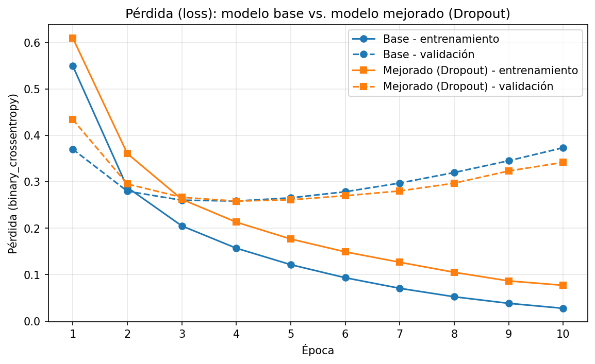

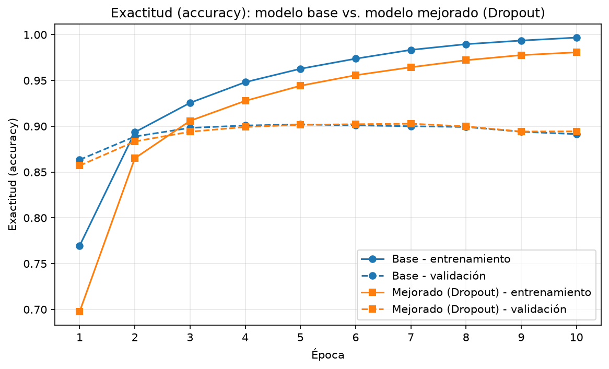

> **ESCRIBE AQUÍ (Steedwar)**
>
> - ¿En qué época se separan las curvas de `loss` del modelo base y qué valores de la tabla lo muestran?
> - ¿Cómo cambió la brecha de accuracy entrenamiento-validación de 0,1054 a 0,0863?
> - ¿Qué muestran las épocas 4 y 10 para cada modelo?

## 3.4 Comparación en el conjunto de prueba

| Modelo | Test loss | Test accuracy | Mejor `val_loss` | Época mejor `val_loss` |
|---|---:|---:|---:|---:|
| Base | 0,4638 | 0,8596 | 0,2585 | 4 |
| Mejorado (Dropout) | 0,4198 | 0,8650 | 0,2584 | 4 |

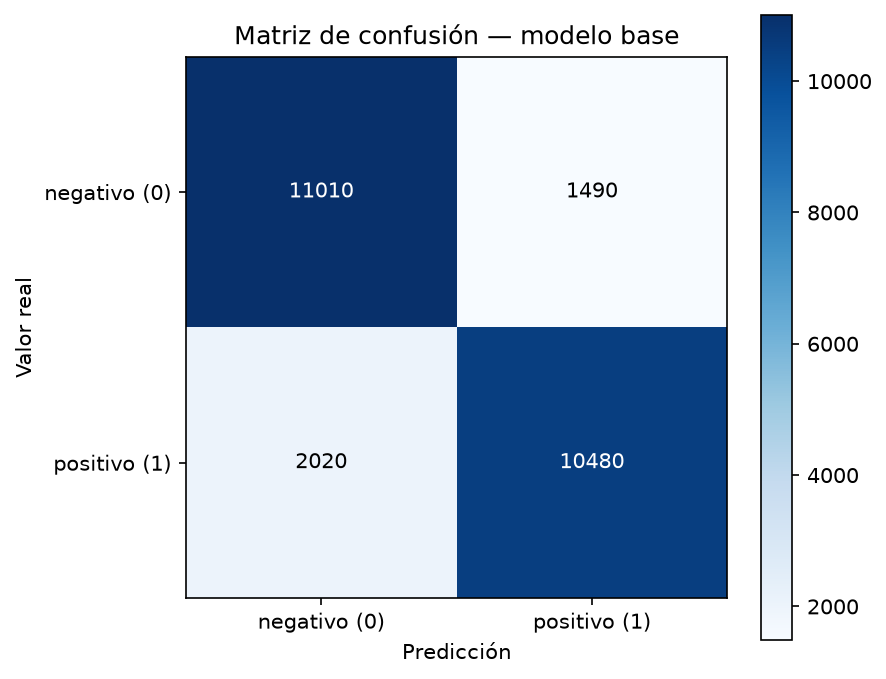


| Matriz `[[TN, FP], [FN, TP]]` | Valor |
|---|---|
| Modelo base | `[[11010, 1490], [2020, 10480]]` |
| Modelo mejorado | `[[11149, 1351], [2024, 10476]]` |

> **ESCRIBE AQUÍ (Steedwar)**
>
> - ¿Qué diferencia observas entre las métricas de prueba 0,8596 y 0,8650?
> - ¿Qué celdas de las dos matrices conviene contrastar para la decisión de triaje?
> - ¿Qué relación tienen las matrices con los 3.375 errores del mejorado?

## 3.5 Análisis de un fallo real

| Campo | Dato exacto |
|---|---|
| Modelo / conjunto | Mejorado (Dropout) / test |
| `idx_test` | 5220 |
| Valor real | 0 (negativo) |
| Predicción | 1 (positivo) |
| Probabilidad de clase positiva | 1,000000 |
| Confianza en la clase predicha | 1,000000 |
| Tipo | Falso positivo |
| Fragmento literal | `Primary plot!Primary direction!Poor interpretation.` |
| Fuente | `notebooks/entrenamiento_u4.ipynb`, celda 58 |

> **ESCRIBE AQUÍ (Steedwar)**
>
> - ¿Qué palabras o estructura del texto de cuatro palabras pudieron confundir al modelo?
> - ¿Cómo se relacionan la predicción positiva 1,000000 y el valor real negativo?
> - ¿Por qué este caso exige discutir la confianza además de la etiqueta predicha?

---

# Sección 4 · Diseño del Agente y Matriz de Evaluación (Unidad 5)

### 4.1 Las Dos Herramientas

El agente dispone de dos herramientas especializadas con responsabilidades no superpuestas:

1. **`@tool #1: clasificar_sentimiento_resena`** ([src/tool_sentimiento.py](src/tool_sentimiento.py)):
   ```python
   @tool
   def clasificar_sentimiento_resena(texto: str) -> str:
       """Clasifica sentimiento de resena en ingles usando red neuronal.

       Usala: usuario entrega texto de resena para clasificar.
       NO usar: saludos, preguntas de politicas o texto ya clasificado.

       Args:
           texto: resena literal en ingles.

       Returns:
           JSON (max 120 chars) con sentimiento, confianza y baja_confianza.
       """
   ```

2. **`@tool #2: consultar_politica_triaje`** ([src/tool_politicas.py](src/tool_politicas.py)):
   ```python
   @tool
   def consultar_politica_triaje(consulta: str, sentimiento: str = None, confianza: float = None) -> str:
       """Consulta la politica interna y protocolo de respuesta para una resena de cliente.

       Usala cuando conozcas el sentimiento/confianza de la resena o cuando el usuario pregunte
       directamente sobre lineamientos, politicas de triaje o protocolos de escalamiento.
       NO la uses para clasificar texto no analizado (usa clasificar_sentimiento_resena) ni
       para saludos o preguntas genericas no relacionadas con politicas.

       Args:
           consulta: pregunta o texto de consulta sobre el protocolo o la resena.
           sentimiento: 'positivo', 'negativo' o 'incierto' (si ya fue inferido).
           confianza: valor flotante de certeza (0.0 a 1.0).

       Returns:
           JSON compacto (max 600 caracteres) con pol_id, prioridad, accion y pauta.
       """
   ```

> ### [ESCRIBE AQUÍ (Juan Diego)] — Análisis de Diseño de Herramientas

En la elavoracion del trabajo tuvimos que tener en cuenta que para que la herramienta del sentimiento no se ejecute innecesariamente mas de una cez sobre el mismo texto implementamos una barrera tecnica. en primer lugar, el prompt del sistema y el docstring de la herramienta contienen instrucciones explícitas de exclusión que le prohíben al agente re-clasificar contenido ya procesado en la conversación. En segundo lugar, gracias a la memoria conversacional, el agente revisa el historial y detecta si ya existe una predicción previa guardada. Al confirmar que ya cuenta con el veredicto de la red neuronal, el agente salta directamente al siguiente paso (consultar la política o responder), ahorrando tiempo y evitando sobrecostos de procesamiento.

Tambien, la herramienta de políticas de triaje fue diseñada como opcionales. Esto lo hicimos porque se desacopla la herramienta y le permite operar en dos escenarios muy distintos: 1. Flujo guiado por el modelo neuronal: Cuando se analiza una reseña completa, el agente envía el sentimiento y la confianza numérica devueltos por la primera herramienta, permitiendo que la política aplique reglas lógicas de certeza (activando de inmediato la revisión humana si la confianza cae por debajo del 70%). 2. Consulta normativa directa: Si un usuario o supervisor pregunta directamente por un protocolo interno (por ejemplo: ¿qué política aplica si un cliente amenaza con demandar?), no existe una reseña previa ni cifras de confianza. Al ser opcionales, la herramienta no falla ni fuerza al agente a inventar datos; simplemente busca en el catálogo de reglas mediante palabras clave y devuelve la política correspondiente

---

### 4.2 Docstrings

Los docstrings actúan como el manual de operaciones del planificador del LLM. Su diseño optimizado incluye directrices explícitas de activación positiva (`Usala:`) y exclusión negativa (`NO usar:`).

> ### [ESCRIBE AQUÍ (Juan Diego)] — Impacto Operativo de los Docstrings

Encontramosque en los agentes basados en LLM, uno de los errores más comunes es la sobre-activasion de herramientas que basicamente es cuando el agente se vuelve ansioso y ejecuta herramientas ante cualquier saludo casual. Para mitigar esto, estructuramos los docstrings bajo una lógica de directrices positivas (Usala cuando...) y exclusiones negativas taxativas (NO usar...). La frase determinante en la primera herramienta fue:

NO usar: saludos, preguntas de politicas o texto ya clasificado.

Gracias a esta instrucción prohibitiva explícita, en el Caso 1 de evaluación el agente reconoció que ante un mensaje de cortesía (Hola, ¿en qué me puedes ayudar?) no debía invocar la red neuronal, respondiendo de inmediato con una lista vacía de herramientas y consumiendo el mínimo de recursos

Entre la Tarea 6 y la Tarea 8 realizamos una depuración profunda en la redacción de los docstrings. Inicialmente eran textos largos y descriptivos que explicaban detalles internos del modelo (como capas o librerías), lo que confundía al planificador y provocaba llamadas desordenadas o duplicadas. Al sintetizarlos como contratos operativos concisos, eliminamos las alucinaciones y delimitamos claramente la frontera entre ambas herramientas: la Tool #1 solo analiza reseñas no clasificadas y la Tool #2 solo atiende reglas y políticas de triaje.

Esta optimización tuvo además un impacto cuantitativo directo en el consumo de contexto. Dado que la definición de las herramientas se concatena y reenvía al modelo en cada paso intermedio del razonamiento, compactar el docstring de la Tool #1 (de 118 a 80 tokens, un 32.2% de ahorro) y el de la Tool #2 (de 199 a 181 tokens, un 9.0% de ahorro) redujo drásticamente el consumo acumulado de tokens de entrada en turnos complejos de doble llamada

---

### 4.3 Memoria y `thread_id`

La memoria conversacional del agente se gestiona a través de un checkpointer volátil en memoria (`MemorySaver`), aislando las sesiones mediante `thread_id`.

#### 1. Creación del Checkpointer y Compilación del Agente ([src/agente.py](src/agente.py))
```python
checkpointer = MemorySaver()
agente = create_react_agent(
    model=llm,
    tools=tools,
    checkpointer=checkpointer,
    prompt=crear_prompt_modifier(SYSTEM_PROMPT_COMPACTO),
)
```

#### 2. Configuración y Generación de Sesión ([src/agente.py](src/agente.py))
```python
def nuevo_thread_id() -> str:
    """Genera un nuevo identificador de sesión único (UUID4)."""
    return str(uuid.uuid4())


def config_sesion(thread_id: str) -> Dict[str, Any]:
    """Retorna la configuración requerida por LangGraph para direccionar la sesión."""
    return {"configurable": {"thread_id": thread_id}}
```

#### 3. Reinicio de Sesión en la Aplicación ([app.py](app.py))
```python
if st.button("🔄 Reiniciar conversación", help="Genera un nuevo thread_id y vacía el historial de pantalla"):
    st.session_state.ag_thread_id = nuevo_thread_id()
    st.session_state.ag_historial = []
    st.rerun()
```

> ### [ESCRIBE AQUÍ (Juan Diego)] — Explicación de la Memoria y Reinicio

Para validar el comportamiento de la memoria conversacional implementamos dos pruebas. En la primera prueba tras clasificar una reseña en un hilo activo, le preguntamos al agente en el siguiente turno: ¿cuál fue la confianza de esa reseña?. El agente respondió con la cifra exacta devuelta por la red neuronal recuperándola directamente del historial del checkpointer sin necesidad de volver a ejecutar la herramienta. Posteriormente, en la segunda prueba que hicimops generamos un nuevo hilo y repetimos la misma pregunta; el agente respondió indicando que no contaba con contexto previo y verificamos que el nuevo hilo iniciaba en blanco, demostrando un borrado y aislamiento perfecto entre sesiones.

Finalmente, para evitar desbordamientos de contexto y sobrecostos en conversaciones extensas, implementamos un recorte dinámico de historial de esta manera restringiendo la memoria a una ventana móvil de los 8 mensajes más recientes y preservando siempre el prompt del sistema. En este mecanismo, configurar el parámetro, fue un requisito crítico para la API de Gemini: si un recorte divide un mensaje del agente con llamadas a herramientas (AIMessage.tool_calls) y deja huérfano su correspondiente mensaje de respuesta (ToolMessage), Google AI Studio rechaza la petición con un error 400 (Bad Request). Al exigir allow_partial=False, LangChain solo descarta bloques completos de interacción, garantizando estabilidad total en turnos prolongados.
---

### 4.4 Cuidado de Tokens y Cuota

Para operar de forma sostenible dentro de la capa gratuita de Google AI Studio (15 RPM), se implementaron 9 medidas de optimización técnica:

| # | Medida de Ahorro | Ubicación en Código | Efecto Medido / Cifra Empírica |
|---|---|---|---|
| 1 | **System prompt compacto (6 directrices)** | [src/agente.py](src/agente.py) | De **395** a **132 tokens** (**66.6% de ahorro**) |
| 2 | **Docstring compacto Tool #1** | [src/tool_sentimiento.py](src/tool_sentimiento.py) | De **118** a **80 tokens** (**32.2% de ahorro**) |
| 3 | **Docstring compacto Tool #2** | [src/tool_politicas.py](src/tool_politicas.py) | De **199** a **181 tokens** (**9.0% de ahorro**) |
| 4 | **Límite duro de caracteres en Tool #1** | [src/tool_sentimiento.py](src/tool_sentimiento.py) | Assert `len(salida) <= 120` (salida real: **66 chars**) |
| 5 | **Límite duro de caracteres en Tool #2** | [src/tool_politicas.py](src/tool_politicas.py) | Assert `len(salida) <= 600` (salida real: **156 chars**) |
| 6 | **Tope de generación (`max_output_tokens`)** | [src/agente.py](src/agente.py) | Limitado a **512 tokens** con `temperature=0` |
| 7 | **Recorte dinámico de historial (`trim_messages`)** | [src/agente.py](src/agente.py) | Ventana máxima de **8 mensajes** recientes (`MAX_MENSAJES_HISTORIAL`) |
| 8 | **Límite de ritmo (`InMemoryRateLimiter`)** | [src/agente.py](src/agente.py) | **0.25 req/seg** (15 RPM) para prevenir errores HTTP 429 |
| 9 | **Tope defensivo de entrada** | [src/config.py](src/config.py), [src/agente.py](src/agente.py) | Truncado automático a **4,000 caracteres** |

#### Comparativa Global Antes vs. Después ([assets/apuntes/medicion_tokens.md](assets/apuntes/medicion_tokens.md))

| Caso Evaluado | Tokens Antes (In / Out / Tot) | Tokens Después (In / Out / Tot) | Ahorro Total (%) |
|---|---|---|:---:|
| **Caso 1: Saludo** | 828 / 106 / 934 | 513 / 48 / 561 | **39.9%** |
| **Caso 2: Pregunta de política** | 2,009 / 147 / 2,156 | 1,255 / 87 / 1,342 | **37.8%** |
| **Caso 3: Reseña completa** | 3,833 / 193 / 4,026 | 2,231 / 129 / 2,360 | **41.4%** |
| **TOTAL SUITE (3 turnos)** | **6,670 / 446 / 7,116** | **3,999 / 264 / 4,263** | **40.1%** |

> ### [ESCRIBE AQUÍ (Juan Diego)] — Justificación de las Medidas de Ahorro

De las 9 medidas implementadas, la que generó el mayor impacto cuantitativo fue la compresión del System Prompt, el cual redujimos de 395 a solo 132 tokens (un ahorro neto del 66.6%). La razón de su enorme impacto radica en el efecto multiplicador del ciclo ReAct: mientras que los mensajes del usuario o las salidas de las herramientas solo se envían en su respectivo turno, el prompt del sistema se inyecta como prefijo obligatorio en absolutamente todas las llamadas que se hacen al LLM. En un flujo completo donde el agente primero planifica, luego invoca la Tool #1, después la Tool #2 y finalmente redacta la respuesta, el system prompt se reenvía hasta tres o cuatro veces en un solo turno de conversación. Reducir 263 tokens en esa plantilla base se traduce en miles de tokens ahorrados a lo largo de una sesión.

Para lograr esta reduccion sin comprometer el comportamiento del agente eliminamos las cosas que no aportaban como la prosa, los fomralismos innecesarios y las explicaciones pedagogicas extensas. En cambio de eso resumimos las instrucciones bajo una sintaxis imperativa y contractual organizada en seis directrices estrictas: rol de triaje, prohibición de re-clasificar, condición de activación de la Tool #1, flujo de argumentos hacia la Tool #2, formato mínimo de respuesta al usuario y mandato de no corregir a la red neuronal en casos de incertidumbre. Este diseño de alta densidad semántica garantizó que el agente mantuviera un 100% de cumplimiento operativo utilizando únicamente una fracción del contexto original.

Esta estrategia se complementó con límites duros en las salidas de las herramientas, obligándolas a devolver JSON compacto en una sola línea que consume un espacio mínimo en el historial. Asimismo, implementamos un limitador de ritmo en memoria a 0.25 peticiones por segundo bindando a la aplicación contra bloqueos por error HTTP 429 en la capa gratuita de Gemini. Por último, en el recorte de historial con trim_messages, el parámetro allow_partial=False fue vital: garantizó que al ahorrar tokens jamás se descartaran mensajes a medias, evitando romper la pareja indivisible entre la llamada a la herramienta y su resultado, lo que habría provocado un fallo de validación en la API. En conjunto, estas medidas lograron un ahorro global medido del 40.1% en la suite de evaluación (reduciendo de 7,116 a 4,263 tokens)
---

### 4.5 Matriz de Evaluación

Resultados reproducibles extraídos de [notebooks/evaluacion_agente_u5.ipynb](notebooks/evaluacion_agente_u5.ipynb) (Celda 12, In[6]):

| Caso | Entrada Resumida | Herramientas Esperadas | Herramientas Invocadas | Trayectoria | Resultado | Tokens Medidos |
|:---|:---|:---|:---|:---:|:---:|---:|
| **Caso 1** (Celda In[2]) | `Hola, ¿qué puedes hacer por mí?` | `[]` | `[]` | **CUMPLE** | **CUMPLE** | 609 |
| **Caso 2** (Celda In[3]) | `¿Qué política debo aplicar si un cliente amenaza c...` | `consultar_politica_triaje` | `consultar_politica_triaje` | **CUMPLE** | **CUMPLE** | 1,365 |
| **Caso 3** (Celda In[4]) | `Haz el triaje de esta reseña de un cliente: "Widow...` *(idx_test: 41)* | `clasificar_sentimiento_resena, consultar_politica_triaje` | `clasificar_sentimiento_resena, consultar_politica_triaje` | **CUMPLE** | **CUMPLE** | 2,230 |
| **Caso 4** (Celda In[5]) | `Haz el triaje de esta reseña de un cliente: "Not b...` *(Caso B)* | `clasificar_sentimiento_resena, consultar_politica_triaje` | `clasificar_sentimiento_resena, consultar_politica_triaje` | **CUMPLE** | **CUMPLE** | 2,130 |

- **Casos con trayectoria correcta sobre el total:** 4 de 4 (**100.0%**)
- **Casos con resultado correcto sobre el total:** 4 de 4 (**100.0%**)
- **Validación de trayectoria:** Determinada exclusivamente desde `AIMessage.tool_calls` a través de `herramientas_invocadas` en `src/agente.py` y verificada en `src/evaluacion.py`. Cero inspecciones sobre la respuesta final de texto.

> ### [ESCRIBE AQUÍ (Juan Diego)] — Análisis de la Matriz de Evaluación

La diferencia entre el caso 1 y el caso 2 demuestra la capacidad de discriminacion del agnete, en el caso 1 'Hola, ¿qué puedes hacer por mí?', el agente identificó un simple saludo de bienvenida y respondió cordialmente sin activar ninguna herramienta de esta manera consumiendo un minimo de tokens de apenas 609. En cambio, en el caso 2 '¿Qué política debo aplicar si un cliente amenaza con demandar?' reconoció una consulta normativa sobre protocolos de escalamiento legal y activó exclusivamente la herramienta de políticas. Esto comprueba que el agente no opera como un script rígido que dispara herramientas por reflejo, sino que planifica selectivamente según la intención del usuario, ahorrando cómputo y preservando cuota.

En el Caso 3 evaluamos el flujo neuro-agéntico completo utilizando una reseña negativa real del conjunto de prueba. El agente ejecutó de forma autónoma la secuencia requerida, primero invocó la @tool #1 para obtener la inferencia de la red local (sentimiento: 'negativo', confianza: 1.0), y acto seguido utilizó esos mismos valores como argumentos para invocar la @tool #2 (sentimiento='negative', confianza=1). La herramienta retornó la política (Ticket de insatisfacción, Prioridad Alta) y el agente estructuró una respuesta final donde comunicó fielmente tanto el sentimiento como las pautas de atención. En el notebook validamos por código mediante asserts que no existió ninguna distorsión entre lo que arrojó la red local y los argumentos recibidos por la política de triaje

El Caso 4 (basado en el primer caso de fallo real: 'Not bad, but not great either...') puso a prueba el comportamiento ético y defensivo del sistema. La red neuronal predijo sentimiento negativo pero con una certeza de apenas 0.5835 (58.35%), quedando por debajo del umbral corporativo de seguridad (UMBRAL_BAJA_CONFIANZA = 0.70). En lugar de 'adivinar' o corregir al modelo por su cuenta, el agente respetó la directriz del sistema: comunicó abiertamente la baja confianza y aplicó la política (Derivar a moderación humana con prioridad media). En un servicio real de streaming, esta prudencia evita automatizar respuestas equivocadas ante clientes con quejas ambiguas. Finalmente, cabe destacar que todas las trayectorias se auditaron inspeccionando directamente los objetos estructurados y no leyendo texto libre, alcanzando un 100.0% de acierto tanto en trayectorias como en resultados (4 de 4 casos cumplidos).
---

# Sección 5 · Bitácora de Vibe Coding y Razonamiento Crítico

Registro unificado de incidencias, errores de librerías, APIs desactualizadas y malas prácticas detectadas durante el desarrollo asistido por IA, ordenado cronológicamente:

| # | Fecha | Tarea | Integrante | Herramienta IA | Qué propuso la IA | Problema detectado | Cómo se corrigió | Captura en `assets/vibe_coding/` | Estado Evidencia |
|---|---|---|---|---|---|---|---|---|:---:|
| 1 | 2026-11-17 | Tarea 6 | Juan Diego | Antigravity | Usar `gemini-2.0-flash` y `gemini-2.0-flash-lite`. | Modelos dados de baja en Google AI Studio (`404 NOT_FOUND`) y respuesta como lista de dicts. | Migración a `gemini-3.5-flash-lite` y normalizador de texto en `responder()`. | `assets/vibe_coding/episodio2.png` | ⚠️ Pendiente captura |
| 2 | 2026-11-17 | Tarea 9 | Steedwar | Antigravity / IA | `modelo.predict(np.array([[limpio]], dtype=object))` | Keras 3 rechaza arrays `object` (`ValueError: Invalid dtype: object`). | `modelo(tf.constant([[limpio]]), training=False)`. | `assets/vibe_coding/episodio1.png` | ⚠️ Pendiente captura |
| 3 | 2026-11-17 | Tarea 10 | Juan Diego | Antigravity | Regla 5 de prompt que solo pedía *"prioridad, accion y pauta"*. | El agente omitía escribir el sentimiento ("negativo") en la respuesta al usuario, fallando el assert. | Se forzó en la regla 5 mencionar sentimiento y confianza detectados. | `assets/vibe_coding/episodio3.png` | ⚠️ Pendiente captura |
| 4 | 2026-11-17 | Tarea 12 | Juan Diego | Antigravity | `@patch("app_agent.responder")` en `AppTest`. | `AppTest` corre en hilo aislado e importaba de nuevo `src.agente`, llamando a la API real. | `patch.object(src.agente, "responder")` interceptando directamente el módulo origen. | `assets/vibe_coding/episodio4.png` | ⚠️ Pendiente captura |
| 5 | 2026-11-17 | Tarea 15 | Steedwar | Codex | Reejecutar notebook de entrenamiento para matrices de confusión. | Sobrescribió incidentalmente `models/sentimiento_imdb.keras`, violando el alcance. | Restauración de pesos desde `HEAD` y aislamiento de celda de matrices. | `assets/vibe_coding/episodio5.png` | ⚠️ Pendiente captura |

---

### Reflexiones del Equipo

> ### [ESCRIBE AQUÍ (Steedwar)] — Reflexión Crítica sobre el Modelado y Vibe Coding
> **Preguntas guía para tu redacción:**
> - ¿Qué precauciones técnicas se deben tener al usar asistentes de IA para el entrenamiento y exportación de modelos en Keras 3?
> - ¿Cómo afectó la incompatibilidad de tipos `dtype=object` la fase de inferencia y cómo se detectó?
>
> *(Redacta aquí tu reflexión crítica personal con tus propias palabras)*

> ### [ESCRIBE AQUÍ (Juan Diego)] — Reflexión Crítica sobre el Agente y Vibe Coding

Entendimos que el desarrollo asistido por modelos generativos ofrece una velocidad impresionante para prototipar, pero que introduce un riesgo el cual consta de que genera una ilusion de que el codigo funciona simplemente por que es visualmente correcta o no arroja errores visibles a primera vista. En arquitecturas agénticas, donde intervienen modelos probabilísticos y múltiples herramientas, los errores no siempre generan excepciones de sintaxis; a menudo se manifiestan como llamadas duplicadas a APIs, omisión de directrices o consumo excesivo de contexto. En este proyecto, la supervisión humana complementada con una batería de pruebas automatizadas y asserts estrictos donde esto nos deja como unico fltro para encontrar las fallas de la IA antes de que se dañe el entorno de produccion y conyebe a multiples conflictos, y mas que la ser un trabajo colaborativo debiamos de entender cualquier decision tomada.

Los incidentes documentados en nuestra bitácora evidencian los peligros que habría conllevado aceptar ciegamente las sugerencias del asistente. En primer lugar, la IA propuso utilizar el modelo gemini-2.0-flash, el cual ya se encontraba descontinuado en Google AI Studio; de no haber auditado la llamada en vivo, la aplicación habría colapsado de inmediato con un error 404 NOT_FOUND ante el evaluador. Fue necesario investigar la documentación oficial vigente, migrar a gemini-3.5-flash-lite y construir un normalizador defensivo de respuestas. En segundo lugar, al crear las pruebas de la interfaz con AppTest, la IA sugirió un decorador @patch('app_agent.responder') que resultaba inútil: como el runner de Streamlit se ejecuta en un hilo aislado, el módulo se volvía a importar en un espacio de nombres independiente, saltándose el mock y consumiendo peticiones reales a la API. De haberlo ignorado, habríamos agotado la cuota gratuita en cuestión de minutos durante las pruebas automáticas.
---

# Sección 6 · Demostración de la Interfaz (Streamlit)

_(introducción pendiente de redactar)_

### Galería de Evidencias de la Aplicación

#### 1. Inferencia Neuronal: Reseña Positiva Clara

*Figura 6.1:* _(descripción pendiente de redactar)_

#### 2. Inferencia Neuronal: Reseña Negativa Clara

*Figura 6.2:* _(descripción pendiente de redactar)_

#### 3. Inferencia Neuronal: Detección de Baja Confianza (Caso B)
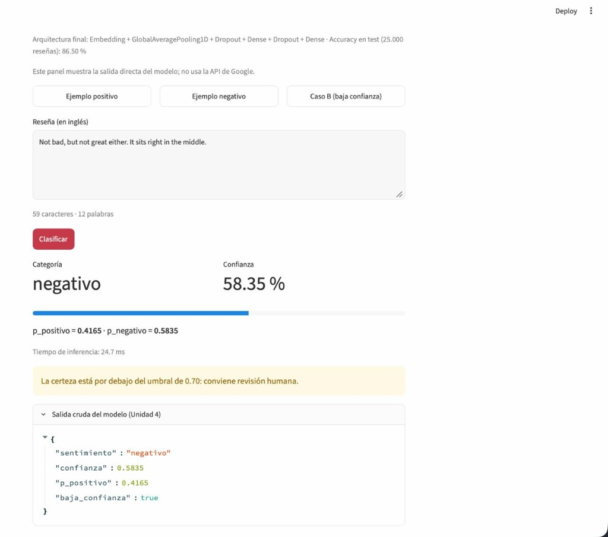
*Figura 6.3:* _(descripción pendiente de redactar)_

#### 4. Fallo Real (Caso A): Predicción Positiva con Confianza Máxima
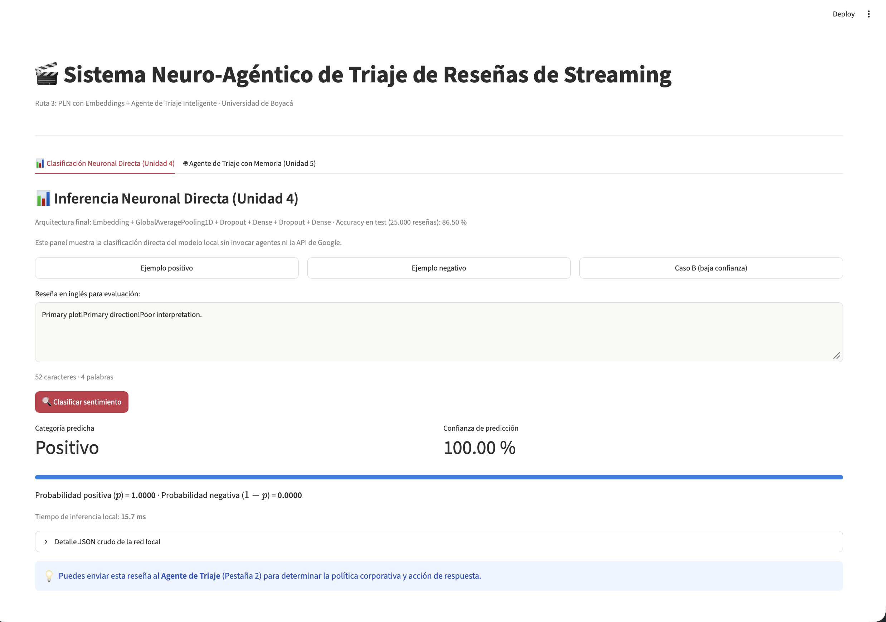
*Figura 6.4:* _(descripción pendiente de redactar)_

#### 5. Agente — Caso 1: Saludo sin Herramientas
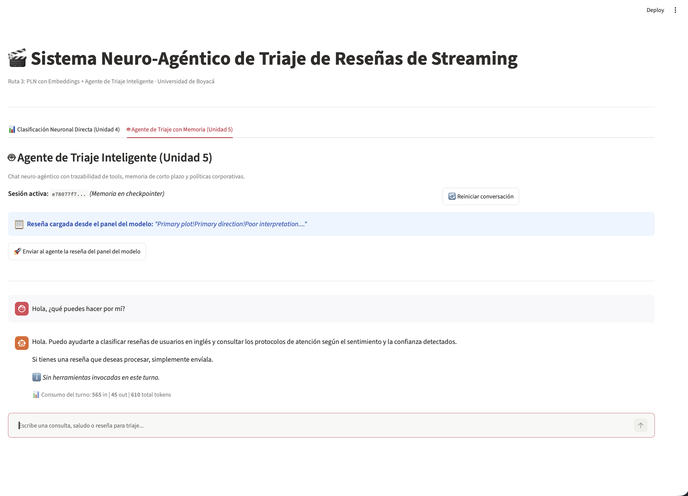
*Figura 6.5:* _(descripción pendiente de redactar)_

#### 6. Agente — Caso 2: Solo Consulta de Política
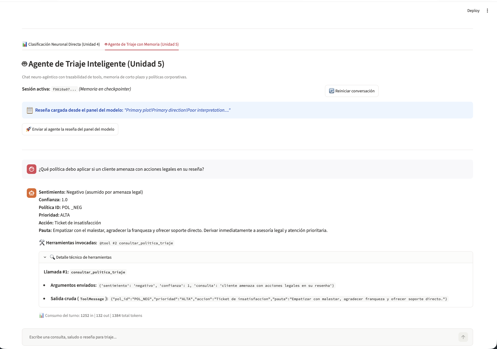
*Figura 6.6:* _(descripción pendiente de redactar)_

#### 7. Agente — Caso 3: Triaje de Reseña Negativa (Clasificación → Política)
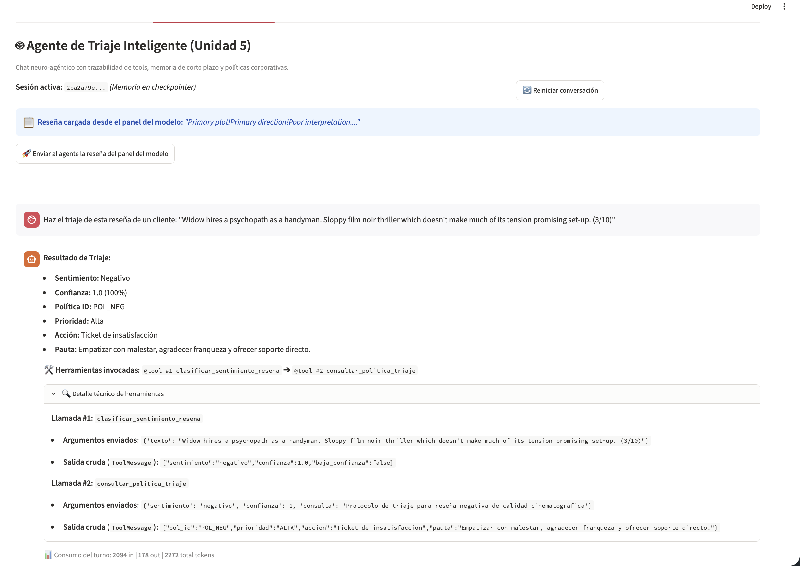
*Figura 6.7:* _(descripción pendiente de redactar)_

#### 8. Agente — Caso 4: Reseña de Baja Confianza (Revisión Humana)
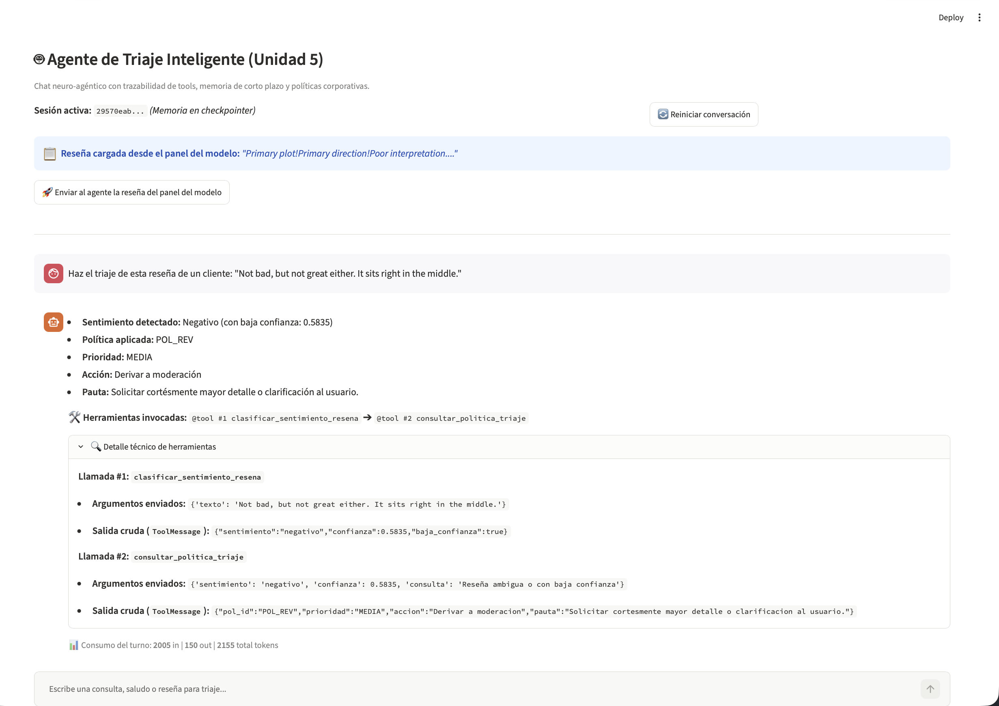
*Figura 6.8:* _(descripción pendiente de redactar)_

#### 9. Agente — Memoria dentro del Mismo Hilo
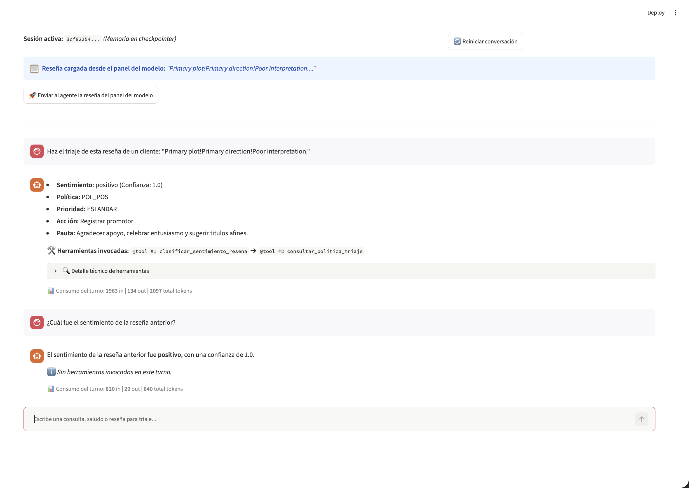
*Figura 6.9:* _(descripción pendiente de redactar)_

#### 10. Agente — Aislamiento de Memoria tras Reiniciar la Conversación
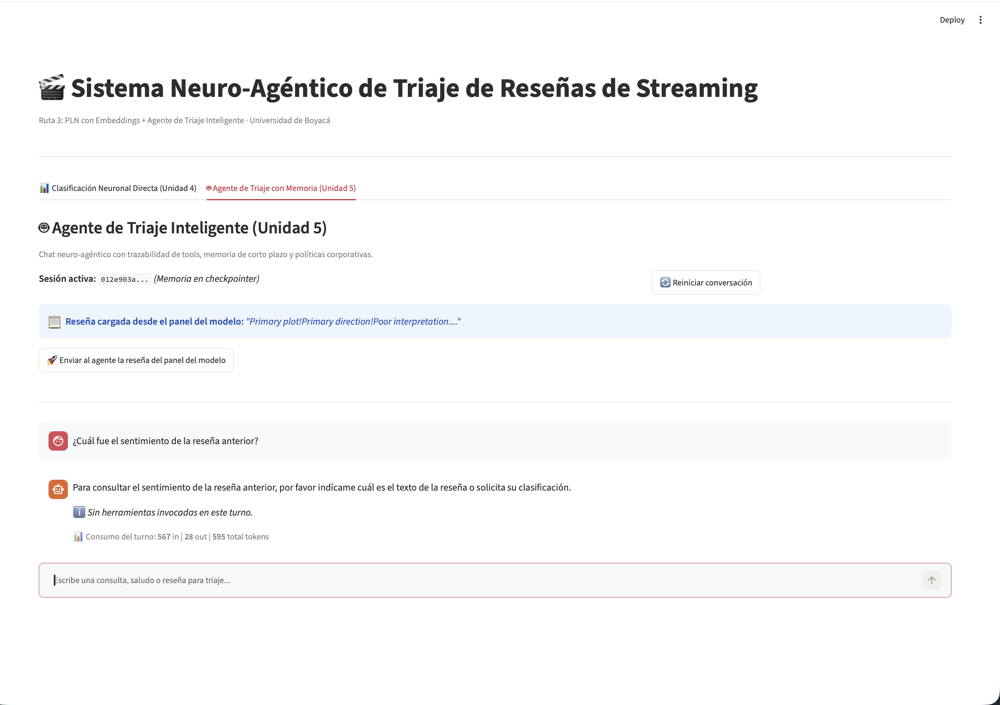
*Figura 6.10:* _(descripción pendiente de redactar)_

---

### Enlace al Video Demostrativo

> ⚠️ **Video Demostrativo del Sistema:**  
> **[ENLACE AL VIDEO DEMOSTRATIVO (YouTube / Google Drive)]()**  
> *(Nota: El enlace se incorporará con permisos públicos de visualización sin requerir inicio de sesión).*

---

# Sección 7 · Guía de Instalación y Ejecución Reproducible

Instrucciones exactas y verificadas para clonar, instalar dependencias, configurar variables de entorno y ejecutar tanto la aplicación interactiva como la suite de evaluación.

### 7.1 Requisitos Previos
* **Python:** Versión 3.10 a 3.12 (recomendado 3.11).
* **Git:** Instalado en el sistema operativo.
* **Clave de API:** Cuenta en [Google AI Studio](https://aistudio.google.com/) para obtener una `GOOGLE_API_KEY` gratuita.

---

### 7.2 Clonación y Configuración del Entorno Virtual

#### En Windows (PowerShell):
```powershell
# 1. Clonar el repositorio
git clone https://github.com/Steedwar17/TallerIA.git
cd TallerIA

# 2. Crear entorno virtual
python -m venv .venv

# 3. Activar entorno virtual
.venv\Scripts\Activate.ps1
```

#### En Linux / macOS (Bash / Zsh):
```bash
# 1. Clonar el repositorio
git clone https://github.com/Steedwar17/TallerIA.git
cd TallerIA

# 2. Crear entorno virtual
python3 -m venv .venv

# 3. Activar entorno virtual
source .venv/bin/activate
```

---

### 7.3 Instalación de Dependencias

Con el entorno virtual activado, instale las versiones exactas fijadas en el proyecto:
```bash
pip install --upgrade pip
pip install -r requirements.txt
```

---

### 7.4 Configuración de Variables de Entorno

Copie la plantilla de variables de entorno y pegue su clave de Google AI Studio:
```bash
# En Windows:
Copy-Item .env.example .env

# En Linux / macOS:
cp .env.example .env
```

Abra el archivo `.env` resultante y defina su clave:
```env
GOOGLE_API_KEY=AIzaSy...tu_clave_aqui
```

> **IMPORTANTE:** El archivo `.env` se encuentra explícitamente ignorado en `.gitignore` para proteger los secretos y prevenir filtraciones en el repositorio.

---

### 7.5 Pesos del Modelo Neuronal

El archivo entrenado de pesos `models/sentimiento_imdb.keras` pesa **7.58 MB** y ya se encuentra versionado directamente dentro del repositorio Git. No requiere descargas externas vía Git LFS ni comandos adicionales (ver [assets/apuntes/descarga_pesos.md](assets/apuntes/descarga_pesos.md)).

---

### 7.6 Ejecución de la Aplicación Streamlit

Para iniciar la aplicación web completa con ambos paneles integrados:
```bash
streamlit run app.py
```
La aplicación se abrirá automáticamente en su navegador en `http://localhost:8501`.

---

### 7.7 Ejecución de los Notebooks de Evaluación

Los notebooks se encuentran en el directorio `notebooks/` y pueden inspeccionarse directamente con sus salidas precomputadas o reejecutarse mediante:
```bash
# Iniciar servidor Jupyter
jupyter notebook

# O ejecutar por consola de forma reproducible:
jupyter nbconvert --to notebook --execute notebooks/evaluacion_agente_u5.ipynb --inplace
```

---

### 7.8 Ejecución de la Suite de Pruebas Automatizadas

Para validar las pruebas unitarias y de integración de la aplicación y el agente sin consumir cuota:
```bash
python -m unittest discover -s src -p "prueba_*.py"
```
