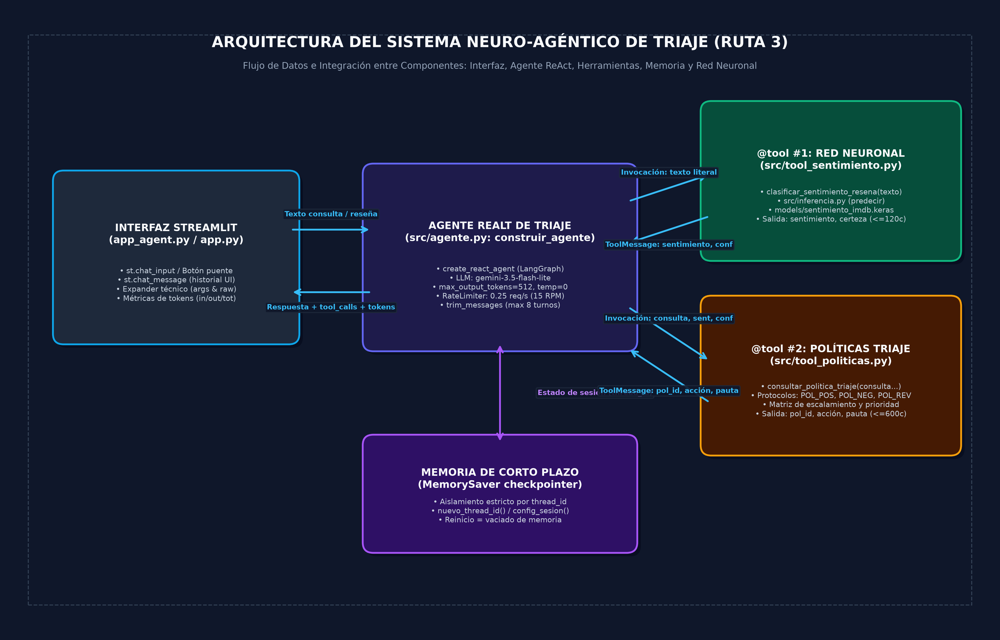
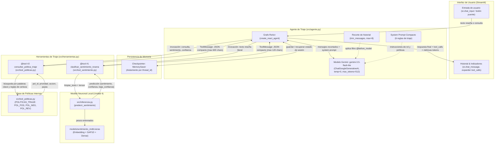

# Secciones 2, 4 y 5 del README — Copia de Trabajo (Juan Diego)

> **AVISO DE INTEGRIDAD Y REGLA DEL TALLER:**  
> Las explicaciones, interpretaciones y conclusiones de este documento deben ser redactadas exclusivamente por **Juan Diego** en los bloques identificados como `ESCRIBE AQUÍ (Juan Diego)`.  
> Queda terminantemente prohibido utilizar texto generado o parafraseado por IA (penalizado con tope de 2.0 según la rúbrica del taller).  
> La evidencia técnica, firmas de código, números y tablas presentadas a continuación son 100% reproducibles y provienen de las ejecuciones reales registradas en `notebooks/evaluacion_agente_u5.ipynb`, `assets/apuntes/medicion_tokens.md` y el código fuente en `src/`.

---

## Sección 2 · Arquitectura del Sistema (Diagrama Propio)

> **ESTADO DEL DIAGRAMA:** `BORRADOR PARA AJUSTAR POR EL EQUIPO`  
> **Decisiones de diseño para revisión de Juan Diego:**
> 1. Verificar si la relación entre la interfaz Streamlit y el agente debe detallar la separación visual entre chat y panel de inferencia.
> 2. Confirmar si la llamada entre el agente y la red neuronal debe explicitar el paso por `src/inferencia.py` antes de los pesos `.keras`.



### Especificación de la Arquitectura en Mermaid



> ### [ESCRIBE AQUÍ (Juan Diego)] — Explicación de la Arquitectura
> **Preguntas guía para tu redacción:**
> - ¿Cómo interactúan el agente ReAct, la red neuronal local y las políticas internas ante una reseña ambigua?
> - ¿Por qué la inferencia de la red neuronal se encapsula en una `@tool` y no se conecta directamente al frontend?
> - ¿De qué manera la memoria (`MemorySaver`) previene re-ejecutar herramientas costosas en turnos consecutivos?
>
> *(Redacta aquí tu explicación con tus propias palabras)*

---

## Sección 4 · Diseño del Agente y Matriz de Evaluación (Unidad 5)

### 4.1 Las Dos Herramientas

El agente dispone de dos herramientas especializadas con responsabilidades no superpuestas:

1. **`@tool #1: clasificar_sentimiento_resena`** ([src/tool_sentimiento.py:16-45](file:///c:/Users/USUARIO/Documents/Inteligencia%20Artificial/TallerIA/src/tool_sentimiento.py#L16-L45)):
   ```python
   @tool
   def clasificar_sentimiento_resena(texto: str) -> str:
       """Clasifica sentimiento de resena en ingles usando red neuronal.

       Usala: usuario entrega texto de resena para clasificar.
       NO usar: saludos, preguntas de politicas o texto ya clasificado.

       Args:
           texto: resena literal en ingles.

       Returns:
           JSON (max 120 chars) con sentimiento, confianza y baja_confianza.
       """
   ```

2. **`@tool #2: consultar_politica_triaje`** ([src/tool_politicas.py:35-85](file:///c:/Users/USUARIO/Documents/Inteligencia%20Artificial/TallerIA/src/tool_politicas.py#L35-L85)):
   ```python
   @tool
   def consultar_politica_triaje(consulta: str, sentimiento: str = None, confianza: float = None) -> str:
       """Consulta la politica interna y protocolo de respuesta para una resena de cliente.

       Usala cuando conozcas el sentimiento/confianza de la resena o cuando el usuario pregunte
       directamente sobre lineamientos, politicas de triaje o protocolos de escalamiento.
       NO la uses para clasificar texto no analizado (usa clasificar_sentimiento_resena) ni
       para saludos o preguntas genericas no relacionadas con politicas.

       Args:
           consulta: pregunta o texto de consulta sobre el protocolo o la resena.
           sentimiento: 'positivo', 'negativo' o 'incierto' (si ya fue inferido).
           confianza: valor flotante de certeza (0.0 a 1.0).

       Returns:
           JSON compacto (max 600 caracteres) con pol_id, prioridad, accion y pauta.
       """
   ```

> ### [ESCRIBE AQUÍ (Juan Diego)] — Análisis de Diseño de Herramientas
> **Preguntas guía para tu redacción:**
> - ¿Qué garantiza que la `@tool #1` no se ejecute dos veces sobre la misma reseña dentro de una misma conversación?
> - ¿Por qué la `@tool #2` acepta `sentimiento` y `confianza` opcionales en lugar de obligar al agente a inferirlos siempre?
>
> *(Redacta aquí tu explicación con tus propias palabras)*

---

### 4.2 Docstrings

Los docstrings actúan como el manual de operaciones del planificador del LLM. Su diseño optimizado incluye directrices explícitas de activación positiva (`Usala:`) y exclusión negativa (`NO usar:`).

> ### [ESCRIBE AQUÍ (Juan Diego)] — Impacto Operativo de los Docstrings
> **Preguntas guía para tu redacción:**
> - ¿Qué frase exacta del docstring de la `@tool #1` impidió que el modelo la invocara durante el saludo del Caso 1?
> - ¿Qué ajuste realizamos entre la Tarea 6 y la Tarea 8 para evitar que el agente alucinara llamadas duplicadas?
> - ¿Cómo influyó la reducción de tokens en los docstrings sobre el consumo total de contexto en turnos multi-llamada?
>
> *(Redacta aquí tu explicación con tus propias palabras)*

---

### 4.3 Memoria y `thread_id`

La memoria conversacional del agente se gestiona a través de un checkpointer volátil en memoria (`MemorySaver`), aislando las sesiones mediante `thread_id`.

#### 1. Creación del Checkpointer y Compilación del Agente ([src/agente.py:180-195](file:///c:/Users/USUARIO/Documents/Inteligencia%20Artificial/TallerIA/src/agente.py#L180-L195))
```python
checkpointer = MemorySaver()
agente = create_react_agent(
    model=llm,
    tools=tools,
    checkpointer=checkpointer,
    prompt=crear_prompt_modifier(SYSTEM_PROMPT_COMPACTO),
)
```

#### 2. Configuración y Generación de Sesión ([src/agente.py:100-115](file:///c:/Users/USUARIO/Documents/Inteligencia%20Artificial/TallerIA/src/agente.py#L100-L115))
```python
def nuevo_thread_id() -> str:
    """Genera un nuevo identificador de sesión único (UUID4)."""
    return str(uuid.uuid4())


def config_sesion(thread_id: str) -> Dict[str, Any]:
    """Retorna la configuración requerida por LangGraph para direccionar la sesión."""
    return {"configurable": {"thread_id": thread_id}}
```

#### 3. Reinicio de Sesión en la Aplicación ([app_agent.py:149-156](file:///c:/Users/USUARIO/Documents/Inteligencia%20Artificial/TallerIA/app_agent.py#L149-L156))
```python
with col_btn:
    if st.button("🔄 Reiniciar conversación", help="Genera un nuevo thread_id y vacía el historial de pantalla"):
        st.session_state.ag_thread_id = nuevo_thread_id()
        st.session_state.ag_historial = []
        st.rerun()
```

> ### [ESCRIBE AQUÍ (Juan Diego)] — Explicación de la Memoria y Reinicio
> **Preguntas guía para tu redacción:**
> - ¿Cómo demostramos empíricamente en la prueba D y E que el agente recuerda en el mismo `thread_id` y olvida al reiniciarlo?
> - ¿Por qué almacenar el agente en `@st.cache_resource` es seguro entre múltiples usuarios que acceden simultáneamente?
> - ¿Qué papel cumple `trim_messages` en evitar desbordamientos de contexto en conversaciones largas?
>
> *(Redacta aquí tu explicación con tus propias palabras)*

---

### 4.4 Cuidado de Tokens y Cuota

Para operar de forma sostenible dentro de la capa gratuita de Google AI Studio (15 RPM), se implementaron 9 medidas de optimización técnica:

| # | Medida de Ahorro | Ubicación en Código | Efecto Medido / Cifra Empírica |
|---|---|---|---|
| 1 | **System prompt compacto (6 directrices)** | [src/agente.py:48-57](file:///c:/Users/USUARIO/Documents/Inteligencia%20Artificial/TallerIA/src/agente.py#L48-L57) | De **395** a **132 tokens** (**66.6% de ahorro**) |
| 2 | **Docstring compacto Tool #1** | [src/tool_sentimiento.py:16-29](file:///c:/Users/USUARIO/Documents/Inteligencia%20Artificial/TallerIA/src/tool_sentimiento.py#L16-L29) | De **118** a **80 tokens** (**32.2% de ahorro**) |
| 3 | **Docstring compacto Tool #2** | [src/tool_politicas.py:38-51](file:///c:/Users/USUARIO/Documents/Inteligencia%20Artificial/TallerIA/src/tool_politicas.py#L38-L51) | De **199** a **181 tokens** (**9.0% de ahorro**) |
| 4 | **Límite duro de caracteres en Tool #1** | [src/tool_sentimiento.py:44](file:///c:/Users/USUARIO/Documents/Inteligencia%20Artificial/TallerIA/src/tool_sentimiento.py#L44) | Assert `len(salida) <= 120` (salida real: **66 chars**) |
| 5 | **Límite duro de caracteres en Tool #2** | [src/tool_politicas.py:84](file:///c:/Users/USUARIO/Documents/Inteligencia%20Artificial/TallerIA/src/tool_politicas.py#L84) | Assert `len(salida) <= 600` (salida real: **156 chars**) |
| 6 | **Tope de generación (`max_output_tokens`)** | [src/agente.py:192](file:///c:/Users/USUARIO/Documents/Inteligencia%20Artificial/TallerIA/src/agente.py#L192) | Limitado a **512 tokens** con `temperature=0` |
| 7 | **Recorte dinámico de historial (`trim_messages`)** | [src/agente.py:157](file:///c:/Users/USUARIO/Documents/Inteligencia%20Artificial/TallerIA/src/agente.py#L157) | Ventana máxima de **8 mensajes** recientes (`MAX_MENSAJES_HISTORIAL`) |
| 8 | **Límite de ritmo (`InMemoryRateLimiter`)** | [src/agente.py:126](file:///c:/Users/USUARIO/Documents/Inteligencia%20Artificial/TallerIA/src/agente.py#L126) | **0.25 req/seg** (15 RPM) para prevenir errores HTTP 429 |
| 9 | **Tope defensivo de entrada** | [src/config.py:14](file:///c:/Users/USUARIO/Documents/Inteligencia%20Artificial/TallerIA/src/config.py#L14), [src/agente.py:233](file:///c:/Users/USUARIO/Documents/Inteligencia%20Artificial/TallerIA/src/agente.py#L233) | Truncado automático a **4,000 caracteres** |

#### Comparativa Global Antes vs. Después ([assets/apuntes/medicion_tokens.md](file:///c:/Users/USUARIO/Documents/Inteligencia%20Artificial/TallerIA/assets/apuntes/medicion_tokens.md))

| Caso Evaluado | Tokens Antes (In / Out / Tot) | Tokens Después (In / Out / Tot) | Ahorro Total (%) |
|---|---|---|:---:|
| **Caso 1: Saludo** | 828 / 106 / 934 | 513 / 48 / 561 | **39.9%** |
| **Caso 2: Pregunta de política** | 2,009 / 147 / 2,156 | 1,255 / 87 / 1,342 | **37.8%** |
| **Caso 3: Reseña completa** | 3,833 / 193 / 4,026 | 2,231 / 129 / 2,360 | **41.4%** |
| **TOTAL SUITE (3 turnos)** | **6,670 / 446 / 7,116** | **3,999 / 264 / 4,263** | **40.1%** |

> ### [ESCRIBE AQUÍ (Juan Diego)] — Justificación de las Medidas de Ahorro
> **Preguntas guía para tu redacción:**
> - ¿Cuál medida de ahorro tuvo el mayor impacto cuantitativo y por qué?
> - ¿Cómo logramos recortar el 66.6% del system prompt sin comprometer ninguna de las 6 reglas de comportamiento?
> - ¿Por qué era crítico configurar `allow_partial=False` en el recorte de historial para la API de Gemini?
>
> *(Redacta aquí tu explicación con tus propias palabras)*

---

### 4.5 Matriz de Evaluación

Resultados reproducibles extraídos de [notebooks/evaluacion_agente_u5.ipynb](file:///c:/Users/USUARIO/Documents/Inteligencia%20Artificial/TallerIA/notebooks/evaluacion_agente_u5.ipynb) (Celda 12, In[6]):

| Caso | Entrada Resumida | Herramientas Esperadas | Herramientas Invocadas | Trayectoria | Resultado | Tokens Medidos |
|:---|:---|:---|:---|:---:|:---:|---:|
| **Caso 1** (Celda In[2]) | `Hola, ¿qué puedes hacer por mí?` | `[]` | `[]` | **CUMPLE** | **CUMPLE** | 609 |
| **Caso 2** (Celda In[3]) | `¿Qué política debo aplicar si un cliente amenaza c...` | `consultar_politica_triaje` | `consultar_politica_triaje` | **CUMPLE** | **CUMPLE** | 1,365 |
| **Caso 3** (Celda In[4]) | `Haz el triaje de esta reseña de un cliente: "Widow...` *(idx_test: 41)* | `clasificar_sentimiento_resena, consultar_politica_triaje` | `clasificar_sentimiento_resena, consultar_politica_triaje` | **CUMPLE** | **CUMPLE** | 2,230 |
| **Caso 4** (Celda In[5]) | `Haz el triaje de esta reseña de un cliente: "Not b...` *(Caso B)* | `clasificar_sentimiento_resena, consultar_politica_triaje` | `clasificar_sentimiento_resena, consultar_politica_triaje` | **CUMPLE** | **CUMPLE** | 2,130 |

- **Casos con trayectoria correcta sobre el total:** 4 de 4 (**100.0%**)
- **Casos con resultado correcto sobre el total:** 4 de 4 (**100.0%**)
- **Validación de trayectoria:** Determinada exclusivamente desde `AIMessage.tool_calls` a través de `herramientas_invocadas` en `src/agente.py` y verificada en `src/evaluacion.py`. Cero inspecciones sobre la respuesta final de texto.

> ### [ESCRIBE AQUÍ (Juan Diego)] — Análisis de la Matriz de Evaluación
> **Preguntas guía para tu redacción:**
> - ¿Qué demuestra que el Caso 1 no active herramientas y el Caso 2 active solo la de políticas?
> - ¿Cómo se garantiza en el Caso 3 que los argumentos de la `@tool #2` coincidan exactamente con la inferencia de la red local?
> - En el Caso 4, ¿por qué fue fundamental que el sistema comunicara la baja confianza (0.5835) y derivara a moderación humana en lugar de automatizar una decisión errónea?
>
> *(Redacta aquí tu explicación con tus propias palabras)*

---

## Sección 5 · Bitácora de Vibe Coding y Razonamiento Crítico (Parte del Agente)

Registro riguroso de fallos reales, alucinaciones de API o malas prácticas detectadas durante el trabajo asistido por IA, con su respectiva corrección y estado de evidencia:

| # | Fecha | Tarea | Herramienta IA | Qué propuso la IA | Problema detectado | Cómo se corrigió | Captura en `assets/vibe_coding/` | Estado Evidencia |
|---|---|---|---|---|---|---|---|:---:|
| 1 | 2026-11-17 | Tarea 9 | Antigravity | `modelo.predict(np.array([[limpio]], dtype=object))` | Keras 3 rechaza arrays `object` (`ValueError: Invalid dtype: object`). | `modelo(tf.constant([[limpio]]), training=False)`. | `assets/vibe_coding/episodio1.png` | ⚠️ Pendiente subir captura |
| 2 | 2026-11-17 | Tarea 6 | Antigravity | Usar `gemini-2.0-flash` y `gemini-2.0-flash-lite`. | Modelos dados de baja en Google AI Studio (`404 NOT_FOUND`) y respuesta como lista de dicts. | Migración a `gemini-3.5-flash-lite` y normalizador de texto en `responder()`. | `assets/vibe_coding/episodio2.png` | ⚠️ Pendiente subir captura |
| 3 | 2026-11-17 | Tarea 10 | Antigravity | Regla 5 de prompt que solo pedía *"prioridad, accion y pauta"*. | El agente omitía escribir el sentimiento ("negativo") en la respuesta al usuario, fallando el assert. | Se forzó en la regla 5 mencionar sentimiento y confianza detectados. | `assets/vibe_coding/episodio3.png` | ⚠️ Pendiente subir captura |
| 4 | 2026-11-17 | Tarea 12 | Antigravity | `@patch("app_agent.responder")` en `AppTest`. | `AppTest` corre en hilo aislado e importaba de nuevo `src.agente`, llamando a la API real. | `patch.object(src.agente, "responder")` interceptando directamente el módulo origen. | `assets/vibe_coding/episodio4.png` | ⚠️ Pendiente subir captura |
| 5 | 2026-11-17 | Tarea 15 | Codex | Reejecutar notebook de entrenamiento para matrices de confusión. | Sobrescribió incidentalmente `models/sentimiento_imdb.keras`, violando el alcance. | Restauración de pesos desde `HEAD` y aislamiento de celda de matrices. | `assets/vibe_coding/episodio5.png` | ⚠️ Pendiente subir captura |

> ### [ESCRIBE AQUÍ (Juan Diego)] — Reflexión Crítica sobre Vibe Coding
> **Preguntas guía para tu redacción:**
> - ¿Por qué la supervisión humana y las pruebas automatizadas con asserts estrictos fueron indispensables para detectar los errores de la IA?
> - ¿Qué riesgos habría implicado aceptar ciegamente la propuesta de modelo `gemini-2.0-flash` o el parche incorrecto de `AppTest`?
>
> *(Redacta aquí tu reflexión crítica personal con tus propias palabras)*
