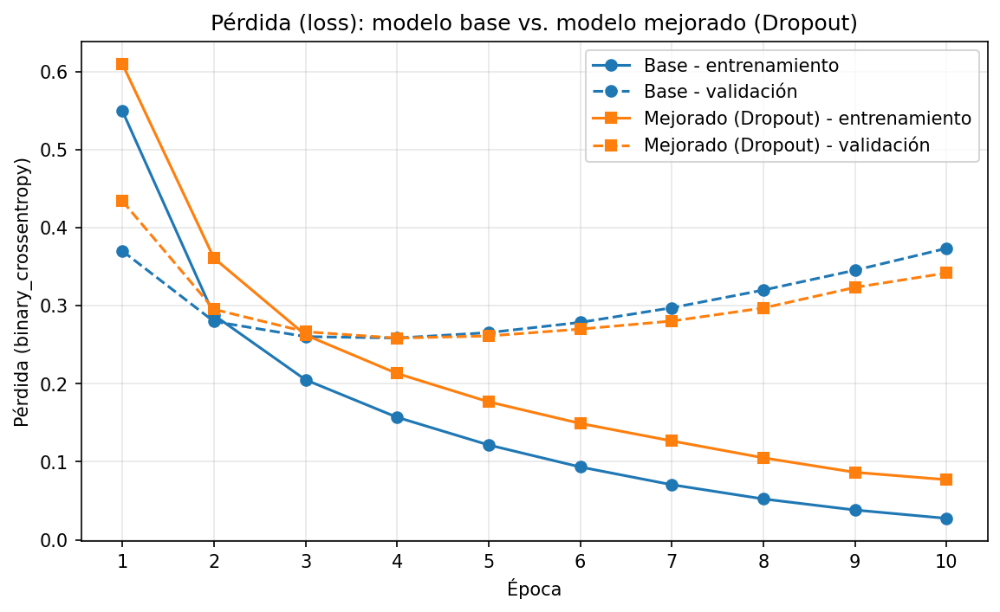
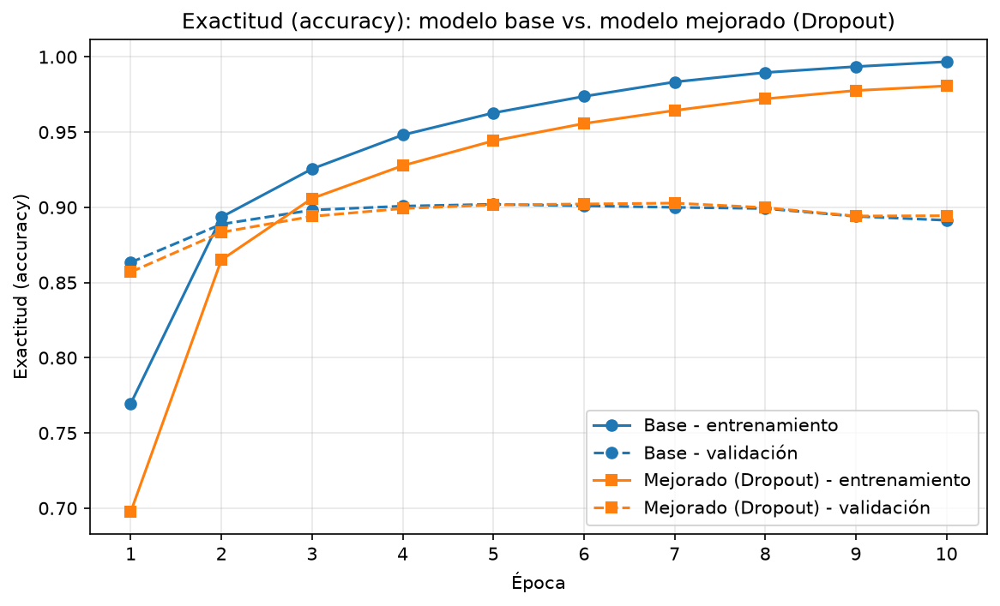
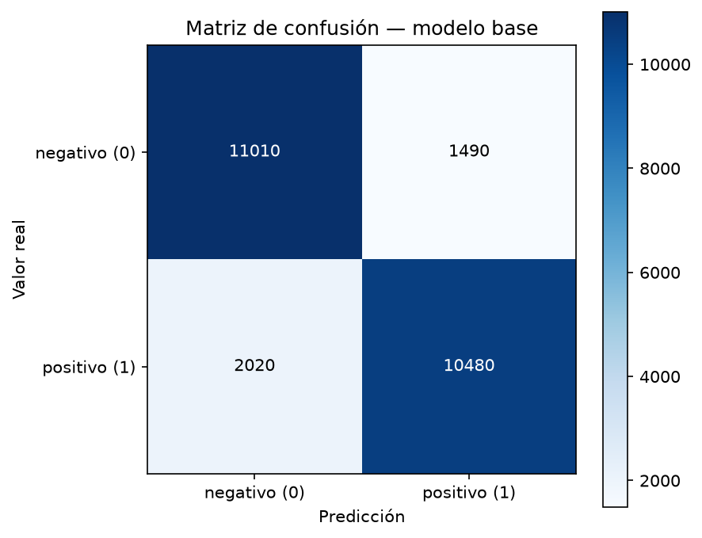
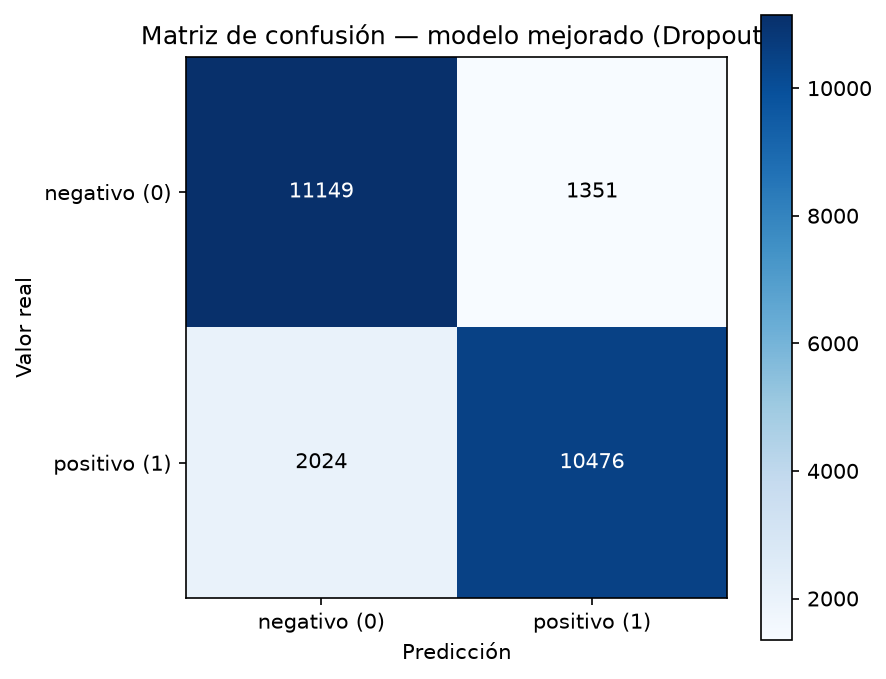

# Sección 3 — Ingeniería del Modelo de Red Neuronal (Unidad 4) y Análisis de un Fallo Real

## 3.1 Datos y preprocesamiento

| Partición | Reseñas | Negativas | Positivas |
|---|---:|---:|---:|
| Train final | 20.000 | 10.000 | 10.000 |
| Validación | 5.000 | 2.500 | 2.500 |
| Test | 25.000 | 12.500 | 12.500 |

| Dato de preprocesamiento | Valor |
|---|---:|
| `MAX_TOKENS` / vocabulario real | 20.000 / 20.000 |
| `MAX_LEN` | 585 |
| Longitud p95 de `train_final` | 585,0 tokens |
| Reseñas de `train_final` truncadas | 4,96% |
| `SEED` | 42 |

> **ESCRIBE AQUÍ (Steedwar)**
>
> - ¿Por qué elegimos `SEQ_LEN=585` al observar p95=585,0, mediana=172 y máximo=2.459?
> - ¿Qué implica que el 4,96% de `train_final` se trunque?
> - ¿Qué evidencia del notebook respalda que el ajuste del vocabulario usó solo `train_final`?

## 3.2 Arquitectura e hiperparámetros

| Hiperparámetro | Modelo base | Modelo mejorado |
|---|---:|---:|
| Embedding | 32 | 32 |
| Pooling | `GlobalAveragePooling1D` | `GlobalAveragePooling1D` |
| Capa densa | 16, ReLU | 16, ReLU |
| Dropout | No aplica | 0,5 (dos capas) |
| Optimizador / learning rate | Adam / 0,001 | Adam / 0,001 |
| Pérdida / métrica | `binary_crossentropy` / `accuracy` | `binary_crossentropy` / `accuracy` |
| Batch / épocas | 64 / 10 | 64 / 10 |
| Parámetros totales | 640.545 | 640.545 |

> **ESCRIBE AQUÍ (Steedwar)**
>
> - ¿Qué ruta siguen los datos desde la secuencia de 585 tokens hasta la salida sigmoide?
> - ¿Qué cambió exactamente entre ambos modelos y qué permaneció constante?
> - ¿Por qué los dos modelos tienen 640.545 parámetros pese a incorporar Dropout?

## 3.3 Curvas de entrenamiento vs. validación

> ⚠️ No existen en el repositorio las rutas prescritas `assets/curvas_base.png`, `assets/curvas_mejorado.png` ni `assets/comparacion_base_vs_mejorado.png`; no se sustituyeron con archivos inexistentes.

> **ESCRIBE AQUÍ (Steedwar)**
>
> - ¿En qué época se separan las curvas de `loss` del modelo base y qué valores de la tabla lo muestran?
> - ¿Cómo cambió la brecha de accuracy entrenamiento-validación de 0,1054 a 0,0863?
> - ¿Qué muestran las épocas 4 y 10 para cada modelo?

## 3.4 Comparación en el conjunto de prueba

| Modelo | Test loss | Test accuracy | Mejor `val_loss` | Época mejor `val_loss` |
|---|---:|---:|---:|---:|
| Base | 0,4638 | 0,8596 | 0,2585 | 4 |
| Mejorado (Dropout) | 0,4198 | 0,8650 | 0,2584 | 4 |

| Matriz `[[TN, FP], [FN, TP]]` | Valor |
|---|---|
| Modelo base | `[[11010, 1490], [2020, 10480]]` |
| Modelo mejorado | `[[11149, 1351], [2024, 10476]]` |

> **ESCRIBE AQUÍ (Steedwar)**
>
> - ¿Qué diferencia observas entre las métricas de prueba 0,8596 y 0,8650?
> - ¿Qué celdas de las dos matrices conviene contrastar para la decisión de triaje?
> - ¿Qué relación tienen las matrices con los 3.375 errores del mejorado?

## 3.5 Análisis de un fallo real

| Campo | Dato exacto |
|---|---|
| Modelo / conjunto | Mejorado (Dropout) / test |
| `idx_test` | 5220 |
| Valor real | 0 (negativo) |
| Predicción | 1 (positivo) |
| Probabilidad de clase positiva | 1,000000 |
| Confianza en la clase predicha | 1,000000 |
| Tipo | Falso positivo |
| Fragmento literal | `Primary plot!Primary direction!Poor interpretation.` |
| Fuente | `notebooks/entrenamiento_u4.ipynb`, celda 58 |

> **ESCRIBE AQUÍ (Steedwar)**
>
> - ¿Qué palabras o estructura del texto de cuatro palabras pudieron confundir al modelo?
> - ¿Cómo se relacionan la predicción positiva 1,000000 y el valor real negativo?
> - ¿Por qué este caso exige discutir la confianza además de la etiqueta predicha?

# Sección 5 — Bitácora de Vibe Coding y Razonamiento Crítico (parte del modelo)

> ⚠️ Fuente aplicada: `assets/apuntes/bitacora_vibe_coding.md`. Esa fuente solo contiene un episodio de la Tarea 9 entre las tareas solicitadas. El directorio `assets/vibe_coding/` no existe; por ello no hay capturas verificables. Las tareas 1, 3, 5, 7 y 11 no se completan con información inventada.

| Fecha | Tarea | Herramienta de IA | Qué propuso | Cuál era el problema | Cómo se corrigió | Captura | Enlace compartido |
|---|---|---|---|---|---|---|---|
| — | 1 | — | ⚠️ Sin episodio en bitácora central | ⚠️ Sin evidencia | ⚠️ Sin evidencia | ⚠️ Sin captura | ⚠️ Sin enlace |
| — | 3 | — | ⚠️ Sin episodio en bitácora central | ⚠️ Sin evidencia | ⚠️ Sin evidencia | ⚠️ Sin captura | ⚠️ Sin enlace |
| — | 5 | — | ⚠️ Sin episodio en bitácora central | ⚠️ Sin evidencia | ⚠️ Sin evidencia | ⚠️ Sin captura | ⚠️ Sin enlace |
| — | 7 | — | ⚠️ Sin episodio en bitácora central | ⚠️ Sin evidencia | ⚠️ Sin evidencia | ⚠️ Sin captura | ⚠️ Sin enlace |
| 2026-11-17 | 9 | No identificado en bitácora central | `modelo.predict(np.array([[limpio]], dtype=object), verbose=0)` | Keras 3 rechaza `dtype=object` (`ValueError: Invalid dtype: object`) | `modelo(tf.constant([[limpio]]), training=False)`; verificado con `src.prueba_inferencia` | ⚠️ Sin captura en `assets/vibe_coding/` | ⚠️ Sin enlace |
| — | 11 | — | ⚠️ Sin episodio en bitácora central | ⚠️ Sin evidencia | ⚠️ Sin evidencia | ⚠️ Sin captura | ⚠️ Sin enlace |

> ⚠️ Cruce bitácora–capturas: episodios reales de Tareas 9 y 15 sin captura; no se detectaron capturas sin episodio porque `assets/vibe_coding/` no existe. La Tarea 15 queda fuera de la tabla porque las filas solicitadas son 1, 3, 5, 7, 9 y 11.

> **ESCRIBE AQUÍ (Steedwar) — Tarea 1**
>
> - ¿Qué episodio real y captura debes aportar para esta tarea?
> - ¿Cómo detectaron el error y qué aprendieron?

> **ESCRIBE AQUÍ (Steedwar) — Tarea 3**
>
> - ¿Qué episodio real y captura debes aportar para esta tarea?
> - ¿Cómo detectaron el error y qué aprendieron?

> **ESCRIBE AQUÍ (Steedwar) — Tarea 5**
>
> - ¿Qué episodio real y captura debes aportar para esta tarea?
> - ¿Cómo detectaron el error y qué aprendieron?

> **ESCRIBE AQUÍ (Steedwar) — Tarea 7**
>
> - ¿Qué episodio real y captura debes aportar para esta tarea?
> - ¿Cómo detectaron el error y qué aprendieron?

> **ESCRIBE AQUÍ (Steedwar) — Tarea 9**
>
> - ¿Cómo detectaron el `ValueError: Invalid dtype: object` en `src.prueba_inferencia`?
> - ¿Qué aprendieron de usar entradas string con Keras 3?

> **ESCRIBE AQUÍ (Steedwar) — Tarea 11**
>
> - ¿Qué episodio real y captura debes aportar para esta tarea?
> - ¿Cómo detectaron el error y qué aprendieron?
